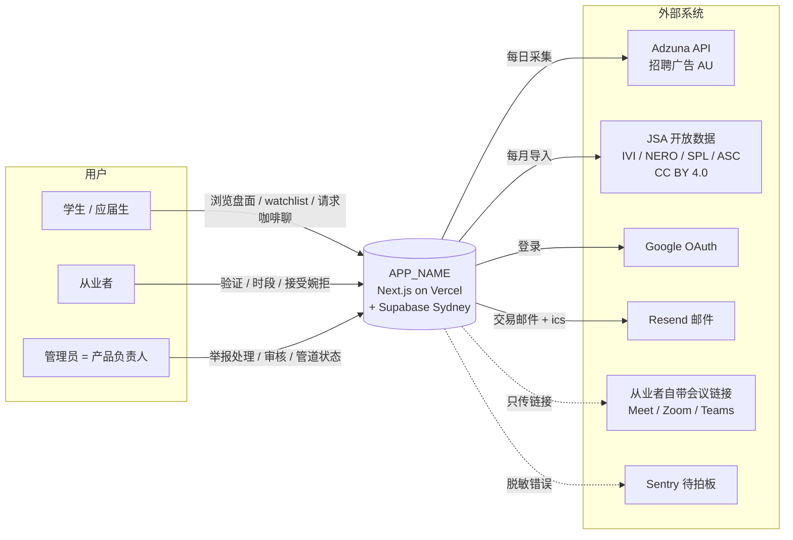
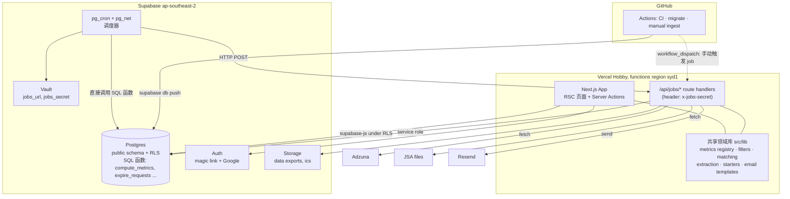
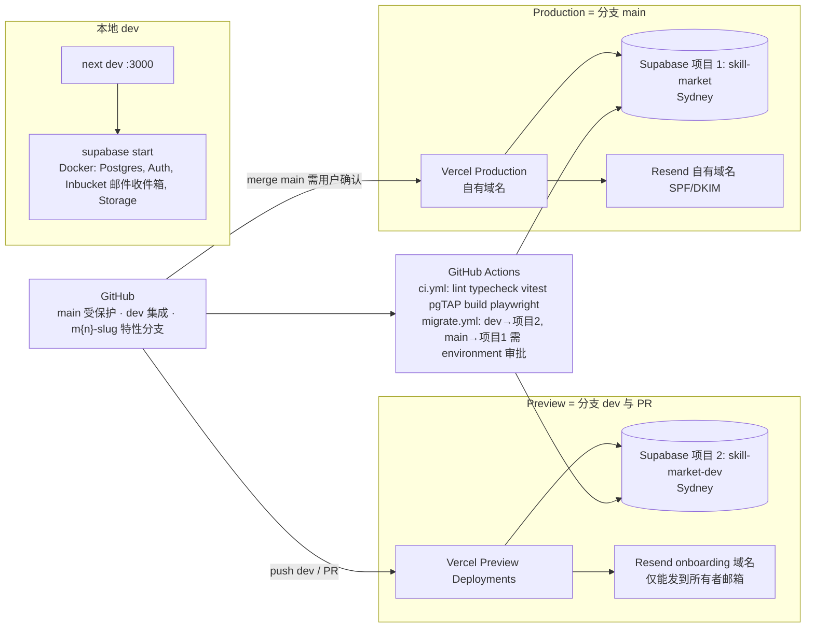
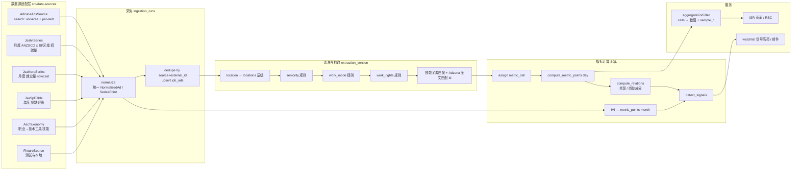
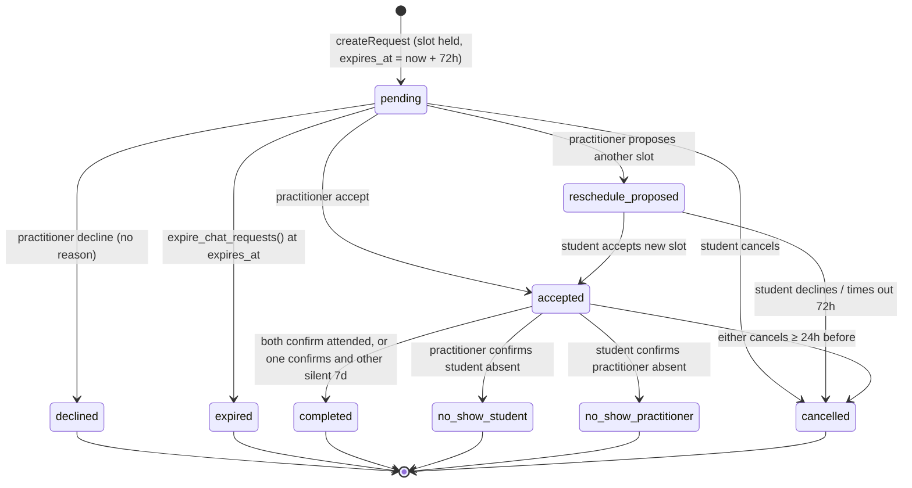
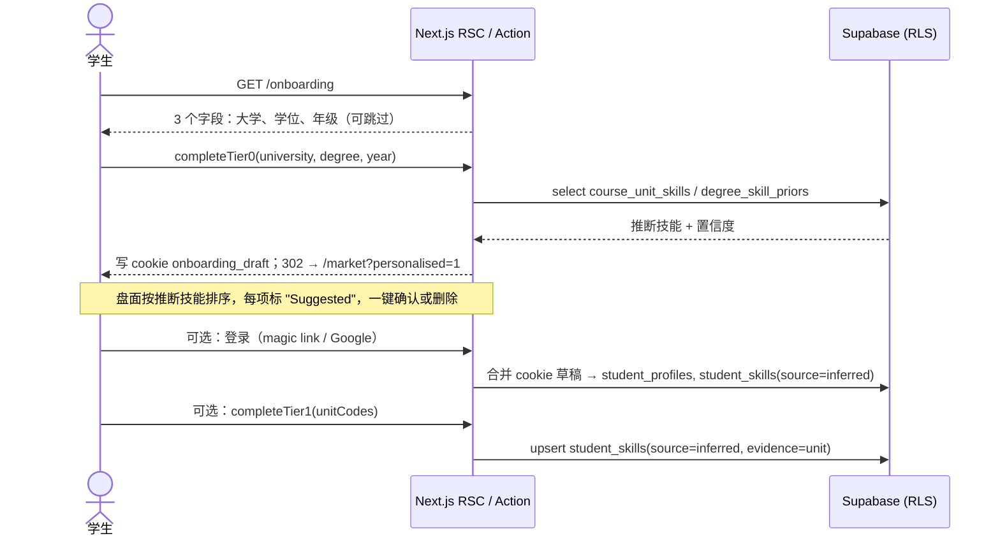
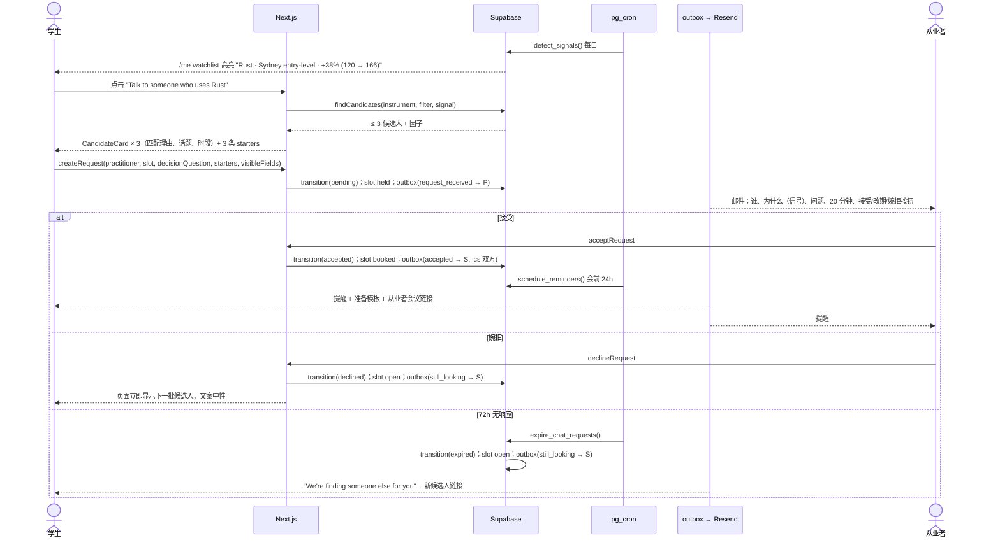
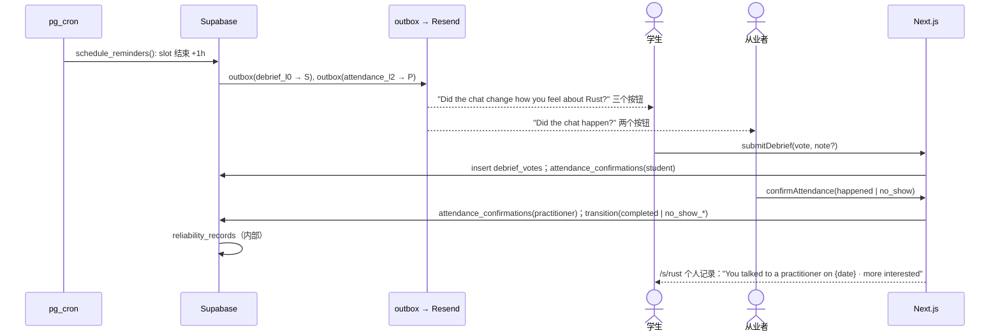

# ARCHITECTURE — skill-market

| 项 | 内容 |
|---|---|
| 状态 | v0.1 — 阶段 1 产出，待产品负责人确认 |
| 依据 | `docs/PRD.md` v0.1、`docs/research/*`、`CLAUDE.md` 已定约束 |
| 维护方 | 主会话（Fable）。implementer / reviewer 只读 |
| 配套 | `docs/MILESTONES.md`（实施顺序）、`docs/PROGRESS.md`（待拍板与进度） |

> 阅读指南：§1 是给产品负责人看的"一页纸"；§2–§11 是给 implementer / reviewer 的实施依据；§12 是所有 PRD 没说清、本文替它做了决定的地方。implementer 只需读与自己里程碑相关的章节，`docs/MILESTONES.md` 里每个里程碑都标了对应章节。

---

## 1. 一页纸总览

**产品**：把澳洲劳动力市场做成可追踪的"盘面"（`skill` / `role` 两类 `instrument`），并由市场信号触发，把学生匹配给持有该技能的在职从业者做 20 分钟咖啡聊。产品名从常量 `APP_NAME` 读取。

**核心架构决策（10 条）**

| # | 决策 | 一句话理由 |
|---|---|---|
| A1 | Next.js App Router 全栈：RSC 渲染公开页 + Server Actions 处理写操作，无独立 API 服务 | 免费档只有一个运行时；Server Actions 自带 CSRF 与类型安全 |
| A2 | Supabase = Postgres + Auth + Storage + **pg_cron 调度**；schema 用纯 SQL migration 管理 | RLS 与调度都放在数据库里，迁移托管商时零改动 |
| A3 | 所有后台任务是幂等、可分片的 HTTP job（`/api/jobs/*`），由 pg_cron + pg_net 定时调用 | 不依赖 Vercel Cron（Hobby 只能每日一次且锁定平台） |
| A4 | **广告级存储 + 可加总的 filter cell** 模型：每条广告归入唯一 (location, work_mode, seniority, work_rights) 格子，指标存 numerator/denominator，任意规则式筛选靠加总得到精确值 | PRD 要求筛选条件是 watchlist 条目的一部分；预计算全部组合不可能，加总模型让任意组合 O(cells) |
| A5 | 数据源适配层：`AdsSource`（Adzuna，技能级）+ `OfficialSeries`（JSA IVI / NERO / SPL / ASC，岗位级）+ `fixture`（测试） | PRD §11：技能级数据从上线起自建快照，岗位级用官方多年历史兜底 |
| A6 | 指标注册表（metric registry）是代码 + 数据库双份、单一来源生成：定义、单位、分母、适用标的类型、最小样本、可用时间窗 | FR-D2 "每个数字解释自己"、FR-M4 "只提供有效组合"变成数据而非散落的 if |
| A7 | 匹配与 conversation starter 全部为**确定性规则**，MVP 不接 LLM | 可解释（FR-C3）、可测试、零 API 成本 |
| A8 | 咖啡聊请求是显式状态机（`pending → accepted/declined/expired/...`），超时由 pg_cron SQL 函数处理，邮件走 outbox 表 | FR-C7/C8 的"静默换人"需要事务性与可重放 |
| A9 | 产品分析事件写入自有表（Sydney），不接第三方分析 SDK；错误监控用 Sentry（待拍板） | Privacy Act / APP 8 跨境最小化 |
| A10 | 测试三层：Vitest（TS 逻辑）+ pgTAP（RLS、SQL 指标函数）+ Playwright（关键流程 + axe 无障碍） | RLS 只能在数据库层验证；核心逻辑一半在 SQL 里 |

**对 PRD 的调整（详见 §12，已按默认执行，用户可否决）**

- 技能级 `growth_12m` 上线时不存在数据，MVP 用 `change_4w`（近 4 周 vs 前 4 周）作为技能的信号指标，`growth_12m` 在累积满 12 个月后自动开放；岗位级 `growth_12m` 从 JSA IVI 历史数据上线即有。
- `no_pr_required_share` 定义为"未明示要求 PR/公民/完整工作权利的广告占比"，界面必须说明"未提及 ≠ 一定可申请"。
- 从业者可约时段 = 每周模板 + 系统按模板生成未来 4 周的 20 分钟 slot；会议链接由从业者自带（PRD Q2 默认）。
- 供给阈值门：`booking_enabled` 特性开关，未开启时"找人聊"入口显示等待队列与从业者招募，不显示空结果。
- 18+ 只做勾选声明（记录时间与版本），不采集出生日期（数据最小化）。

---

## 2. 技术选型

已定栈：Next.js（TypeScript）+ Supabase（ap-southeast-2）+ Vercel + Resend + GitHub Actions，全部免费档。下表是在此之内的具体选择；每项给出一个被否决的备选。

| 领域 | 选择 | 理由 | 被否决的备选 | 否决原因 |
|---|---|---|---|---|
| 框架版本 | Next.js 16（App Router、RSC、Server Actions、`proxy.ts`）+ React 19 + Node 22 LTS + pnpm | 当前稳定版；`output: 'standalone'` 保证可打包到任何 Node/容器平台 | Pages Router | 无 RSC，公开页数据获取要走客户端，LCP 与缓存都更差 |
| 数据访问 | **Supabase CLI 纯 SQL migrations** 作为 schema 唯一来源 + `supabase gen types` 生成类型 + `@supabase/ssr` / `supabase-js` 访问（用户请求走 RLS；job 走 service role） | schema、RLS、pg_cron、函数都在 SQL 里，一处定义；生成类型保证 strict | Prisma | 需要直连与 shadow DB，与 Supabase `auth` schema 冲突；绕过 RLS；serverless 冷启动更重 |
| 校验 | Zod（Server Action 输入、环境变量、job payload、适配器输出） | 单一校验库，类型推导 | Valibot | 生态更小，implementer 熟悉度低 |
| UI | Tailwind CSS v4 + shadcn/ui（Radix 原语，源码拷入仓库） | 可访问性开箱即用；组件可完全定制；无运行时 CSS-in-JS | MUI | 包体大、主题化困难，移动端 LCP 目标难达成 |
| 图表 | 自研 **服务端渲染 SVG sparkline**（零客户端 JS）+ **Recharts**（完整走势图，`dynamic()` 按需加载）+ 每张图配数据表视图 | 列表行 sparkline 数量多，必须零 JS；完整图需要 tooltip 与切换 | Chart.js | Canvas 渲染，屏幕阅读器无 DOM 可读，主题变量接入困难 |
| 表单 | 原生 `<form>` + Server Actions + `useActionState`，客户端只做轻量校验 | 渐进增强，JS 未加载也能提交；少一层抽象 | react-hook-form + tRPC | 增加两层客户端抽象，对本产品的表单复杂度不值得 |
| i18n | `next-intl`（不启用 locale 路由，单 locale 模式），文案在 `messages/en.json` | 满足 FR-A8 "文案集中管理"，日后加语言只需加文件与路由 | react-i18next | 客户端为主，RSC 支持弱 |
| 邮件 | Resend + React Email 模板；Supabase Auth 的 SMTP 也指向 Resend | 一个发信通道；模板可预览、可测试 | Supabase 默认 SMTP | 仅供测试，每小时个位数配额 |
| 后台任务 | **pg_cron**（调度）+ **pg_net**（HTTP 调用 `/api/jobs/*`）+ 纯 SQL 函数（DB 内任务） | 免费、在 Supabase 内、不绑定 Vercel；任务代码仍在 Next.js 仓库里 | Vercel Cron | Hobby 只允许每日一次精度；平台专有 |
| 数据采集运行位置 | 同上：`/api/jobs/ingest-*` 分片 tick（每次 < 50s，游标存表），GitHub Actions 只提供手动触发兜底 | 单一 job 运行时；Vercel 函数时长限制靠分片规避 | GitHub Actions 定时 workflow 跑采集 | 定时精度差（高峰延迟 15–30 分钟），每月 2000 分钟对高频任务不够 |
| 速率限制 | Postgres 表 + 函数 `check_rate_limit()` | 数据留在 AU；无新供应商 | Upstash Redis | 多一个供应商，且数据出境 |
| 错误监控 | Sentry（EU region，`sendDefaultPii=false`，自定义 scrub）**待拍板** | 免费 5K 错误/月；Next.js 集成成熟 | 不接任何外部错误监控 | 生产事故只能靠用户反馈发现 |
| 产品分析 | 自有 `analytics_events` 表 + 管理后台 SQL 看板 | 数据不出 Sydney；事件量小 | PostHog | 免费档托管在 US/EU，需额外跨境披露 |
| 日志 | `pino` 结构化 JSON 到 stdout（Vercel Logs） | 零成本；字段化便于搜索 | Axiom/Logtail | 额外供应商 |
| 测试 | Vitest + pgTAP（`supabase test db`）+ Playwright（Chromium）+ `@axe-core/playwright` | 见 A10 | Jest | ESM/TS 配置繁琐，慢 |
| 密钥扫描 | gitleaks（CI）+ Dependabot | 私有仓库无免费 push protection | GitHub Secret Protection | 付费 |
| 日历文件 | `ics` npm 包生成 `.ics` 附件 | 小、纯函数 | 接 Google Calendar API | 需要额外 OAuth scope，违背最小权限 |

---

## 3. 系统图

### 3.1 系统上下文



### 3.2 容器 / 组件图



### 3.3 部署与环境



环境约定：

| 环境 | 代码 | 数据库 | 邮件 | 登录 | 用途 |
|---|---|---|---|---|---|
| local | `next dev` | `supabase start`（Docker） | Inbucket（本地收件箱） | magic link（本地）；Google 需真实 client 可选 | 开发、全部自动化测试 |
| preview | Vercel Preview（`dev` 分支与 PR） | Supabase 项目 2 `skill-market-dev` | Resend `onboarding@resend.dev` | Google Testing 模式（≤100 测试用户） | 集成验收、可用性测试 |
| production | Vercel Production（`main`） | Supabase 项目 1 `skill-market` | Resend 自有域名 | Google Production | 真实用户 |

Supabase 免费档允许 2 个项目，正好一 prod 一 dev。migration 通过 `supabase db push` 由 GitHub Actions 执行；生产 push 放在 GitHub `production` environment 下需人工审批（与 CLAUDE.md "合并到 main 前必须找用户"一致）。

---

## 4. 前端架构

### 4.1 路由与信息架构

```
/                                  首页：搜索 + 默认筛选下的盘面速览 + 产品说明（未登录可用）
/market?type=skill|role&metric=&f= 盘面列表（列表行 ticker card），URL 即状态
/s/[slug]                          技能完整页
/r/[slug]                          岗位完整页
/compare?a=<slug>&b=<slug>&f=      两标的并排对比
/search?q=                         搜索（别名归一）
/metrics/[key]                     指标定义页（popover 的落地页版本）
/sources                           数据来源、许可、抽取方法与已知误差、更新时间
/onboarding                        Tier 0 → Tier 1（可随时跳过）
/me                                30 秒速览：watchlist + 信号高亮 + 待处理请求
/me/skills                         技能画像（已确认 / 建议 / 下一步）
/me/gap?role=<slug>                缺口诊断
/me/requests                       我的咖啡聊请求
/me/settings                       账号、字段可见性、邮件偏好、UI 模式、导出、删除
/practitioner/join                 从业者注册 + 工作邮箱验证
/practitioner                      从业者面板：收到的请求、时段模板、暂停开关
/chat/new?instrument=&signal=&f=   "找人聊"流程：候选人 → 时段 → 决策问题 → 发送
/chat/[id]                         请求详情（双方各自视角）、复盘投票 / 出席确认
/admin/reports · /admin/review · /admin/pipeline · /admin/metrics · /admin/taxonomy
/legal/privacy · /legal/terms · /legal/conduct · /legal/reliability
/auth/login · /auth/callback · /auth/signout
/api/jobs/[job]                    后台任务入口（POST，`x-jobs-secret`）
/api/health                        健康检查（查询 DB，一并用于保活）
```

路由组：`(public)`、`(student)`、`(practitioner)`、`(admin)`，各自的 `layout.tsx` 做鉴权守卫；`proxy.ts` 只做 Supabase session 刷新，不做业务判断。

### 4.2 核心组件

所有组件在 `src/components/`，按领域分目录；文案一律来自 `messages/en.json`（`useTranslations` / `getTranslations`），`APP_NAME` 通过 `src/config/app.ts` 注入。

| 组件 | 说明 |
|---|---|
| `TickerRow` / `TickerCard` / `TickerPage` | 三种尺寸共用一个数据形状 `InstrumentSnapshot`（当前值、变化、sparkline 序列、样本量、来源、更新时间）和一个 `TickerCore` 子组件；尺寸只决定露出哪些字段 |
| `ChangeBadge` | 强制同时显示相对值与绝对值（`+38% (120 → 166 ads)`），上下方向用图标 + 文字 + 颜色三重编码（NFR-3） |
| `MetricDefinitionPopover` | 任意数字旁的 ⓘ；内容来自 metric registry：定义、单位、分母、时间窗、地理、层级、来源、更新时间、抽取方法与误差 |
| `SourceBadge` | 官方统计 / 广告聚合 / 从业者经验 三种固定标识（FR-D5） |
| `MetricSwitcher` | 只列出 registry 中对该 `instrument_type` 有效且当前数据窗口可用的指标；分 默认 / 常用 / 进阶 三组 |
| `FilterRuleBuilder` | 规则式：一条规则 = `work_mode` + 地点多选（层级树）；"再加一条规则"渐进披露；`seniority`、`work_rights` 同层 |
| `FilterReadback` | 任何筛选状态的自然语言回读（FR-F3），由 `describeFilter()` 纯函数生成，可单测 |
| `SparklineSvg` | RSC 渲染的内联 SVG，带 `<title>`/`<desc>` 与隐藏数据表 |
| `TrendChart` | 客户端 Recharts，`dynamic(() => import(...), { ssr: false })`；旁边有"查看数据表"切换 |
| `SampleWarning` | `sample_n < min_sample` 时替代趋势线，给出放宽筛选的建议按钮 |
| `CompositionList` | 岗位 → 成分技能与权重；技能 → 持有它的岗位；同现技能，全部可点 |
| `SkillProfileBoard` | 已确认 / 建议（带置信度、一键确认或删除）/ 下一步 三栏；无排名、无分数 |
| `GapDiagnosis` | 最多 3 个优先项，每项附相关性、entry-level 适用性、可迁移性、学习投入 |
| `CandidateCard` | 匹配理由（来自可解释因子）、话题、时段、入行路径 |
| `RequestStatus` | pending 状态的安心文案 + 超时后的"我们在找下一位" |
| `DebriefVote` | 三个按钮一次点击 + 可选一行备注 |

### 4.3 数据获取与缓存

| 页面类型 | 渲染 | 缓存 | 说明 |
|---|---|---|---|
| 公开盘面、标的页、对比、指标定义、来源页 | RSC，`export const revalidate = 3600` + 管道跑完后 `revalidateTag('market')` | ISR，全站共享 | 筛选参数在 URL 上；常见组合命中缓存，长尾组合按需渲染后缓存 |
| `/me/*`、`/practitioner/*`、`/chat/*`、`/admin/*` | 动态 RSC（`cookies()` 触发） | 不缓存 | 走用户 session + RLS |
| 写操作 | Server Actions | — | Zod 校验 → 领域函数 → `revalidatePath` |
| 搜索 | RSC + `searchParams` | 短 ISR（60s） | 别名表在内存做前缀匹配，数据库做 `ilike` 兜底 |

不使用 Vercel KV / Blob / Edge Config / Edge Middleware 专有 API；ISR 与 `revalidateTag` 是 Next.js 标准能力，OpenNext（Cloudflare）与 standalone 部署均支持。

### 4.4 设计系统与无障碍

- Tailwind v4 主题 token 在 `src/styles/theme.css`：语义色 `--up`、`--down`、`--flat`、`--warn`，浅色/深色两套；涨跌永不只靠颜色。
- 字体：`next/font` 自托管系统级无衬线；数字使用 `font-variant-numeric: tabular-nums`。
- 断点：375px 优先，所有核心流程在 375px 下单列完成；≥768px 双列。
- 无障碍：所有交互元素来自 Radix（键盘、焦点、ARIA）；图表配 `<title>`/`<desc>` 与数据表；`prefers-reduced-motion` 关闭动画；颜色对比 ≥ 4.5:1；Playwright + axe 对 6 个关键页面做自动检查（见 §10）。
- 隐喻开关：`ui_mode ∈ market | plain`（登录用户存 profile，匿名存 cookie）；影响的仅是一组术语文案（`watchlist` ↔ `tracking`、`ticker` ↔ `card` 等），通过 `messages/en.json` 的两个命名空间切换实现。
- 文案原则（§10 UX）在组件层固化：`ChangeBadge` 不允许只传相对值；`SkillProfileBoard` 没有百分位 prop；`RequestStatus` 没有 "declined by" 文案分支。

---

## 5. 后端架构

### 5.1 数据模型（ER）

```mermaid
erDiagram
    profiles ||--o| student_profiles : has
    profiles ||--o| practitioner_profiles : has
    profiles ||--o{ consents : records
    profiles ||--o{ watchlist_items : owns
    profiles ||--o{ student_skills : has
    profiles ||--o{ email_preferences : has

    instruments ||--o{ instrument_aliases : has
    instruments ||--o{ instrument_relations : from
    instruments ||--o{ metric_points : measured
    instruments ||--o{ watchlist_items : tracked
    instruments ||--o{ student_skills : skill
    instruments ||--o{ practitioner_skills : skill
    instruments ||--o{ job_ad_skills : tagged
    instruments ||--o{ course_unit_skills : maps

    metric_cells ||--o{ metric_points : cell
    locations ||--o{ metric_cells : location
    locations ||--o{ locations : parent
    metric_definitions ||--o{ metric_points : metric

    data_sources ||--o{ ingestion_runs : runs
    data_sources ||--o{ job_ads : from
    job_ads ||--o{ job_ad_skills : has
    locations ||--o{ job_ads : located

    universities ||--o{ course_units : offers
    course_units ||--o{ course_unit_skills : implies

    practitioner_profiles ||--o{ practitioner_skills : holds
    practitioner_profiles ||--o{ practitioner_topics : offers
    practitioner_profiles ||--o{ availability_templates : weekly
    practitioner_profiles ||--o{ availability_slots : generated
    practitioner_profiles ||--o{ work_email_verifications : verifies

    watchlist_items ||--o{ signals : triggers
    signals ||--o{ chat_requests : context
    availability_slots ||--o| chat_requests : booked
    chat_requests ||--o{ chat_request_events : audit
    chat_requests ||--o| debrief_votes : L0
    chat_requests ||--o{ attendance_confirmations : L2
    chat_requests ||--o{ reports : about
    profiles ||--o{ reliability_records : has
    profiles ||--o{ notifications_outbox : to
    profiles ||--o{ blocks : blocker
    profiles ||--o{ waitlist_entries : waits
    profiles ||--o| account_deletions : requested
    profiles ||--o{ data_exports : requested

    profiles {
        uuid id PK
        text display_name
        text timezone
        text ui_mode
        boolean is_admin
        timestamptz created_at
        timestamptz deleted_at
    }
    student_profiles {
        uuid user_id PK
        uuid university_id
        text degree
        smallint study_year
        text visa_status_optional
        jsonb field_visibility
    }
    practitioner_profiles {
        uuid user_id PK
        smallint entry_year
        uuid current_role_instrument_id
        text industry
        text work_email_domain
        text verification_status
        smallint monthly_cap
        boolean paused
        text meeting_link
        text intro_path
    }
    instruments {
        uuid id PK
        text instrument_type
        text slug
        text name
        text anzsco_code
        text status
    }
    instrument_relations {
        uuid from_id FK
        uuid to_id FK
        text relation
        numeric weight
        text source
        timestamptz computed_at
    }
    locations {
        uuid id PK
        text kind
        uuid parent_id
        text name
        text adzuna_key
        text jsa_code
    }
    metric_cells {
        uuid id PK
        uuid location_id FK
        text work_mode
        text seniority
        text work_rights
    }
    metric_definitions {
        text key PK
        text name
        text definition
        text unit
        text denominator
        text[] applicable_types
        text tier
        int min_sample
        text source_kind
        int available_after_days
    }
    metric_points {
        uuid instrument_id FK
        uuid cell_id FK
        text metric_key FK
        text period
        date period_start
        numeric numerator
        numeric denominator
        int sample_n
        text source_key
        timestamptz computed_at
    }
    job_ads {
        uuid id PK
        text source_key FK
        text external_id
        text title
        text company_name
        uuid location_id FK
        text work_mode
        text seniority
        text work_rights
        numeric salary_min
        numeric salary_max
        text contract_type
        date posted_at
        text raw_snippet
        smallint extraction_version
    }
    watchlist_items {
        uuid id PK
        uuid user_id FK
        uuid instrument_id FK
        text status
        jsonb filter
        text filter_hash
        text metric_key
        numeric baseline_value
        timestamptz baseline_at
    }
    signals {
        uuid id PK
        uuid instrument_id FK
        uuid watchlist_item_id FK
        text metric_key
        text kind
        numeric from_value
        numeric to_value
        int sample_n
        timestamptz detected_at
    }
    chat_requests {
        uuid id PK
        uuid student_id FK
        uuid practitioner_id FK
        uuid slot_id FK
        uuid signal_id
        uuid instrument_id FK
        jsonb filter_snapshot
        text decision_question
        jsonb starters
        jsonb student_visible_fields
        text status
        timestamptz expires_at
        timestamptz responded_at
    }
    availability_slots {
        uuid id PK
        uuid practitioner_id FK
        timestamptz start_at
        timestamptz end_at
        text status
    }
    notifications_outbox {
        uuid id PK
        uuid to_user_id FK
        text template
        jsonb payload
        timestamptz scheduled_at
        timestamptz sent_at
        text status
        int attempts
    }
```

**设计要点**

- `instruments.instrument_type` 是 Postgres enum：`skill | role | industry | employer | credential`；MVP 只写入前两种，`status = reserved` 的类型在 UI 层被 registry 过滤，新增类型无需改表（FR-D7）。
- `instrument_relations.relation`：`role_has_skill`（岗位成分，权重来自 ASC 技术工具表 + 广告共现）、`skill_cooccurs`（同现，权重 = 共现率）、`skill_adjacent`（匹配降级用，由共现派生）。
- `watchlist_items.filter` 是 `FilterSpec` JSON（§6.3），`filter_hash` 为其规范化哈希；`baseline_value` 记录加入时的值，用于 FR-W2。
- `chat_requests.student_visible_fields` 在发送时快照学生允许从业者看到的字段（FR-C11）；从业者永远只读这个快照，不读 `student_profiles`。
- 学生敏感字段（签证状态等）单独放在 `student_profiles` 的可选列且默认 `field_visibility` 为仅自己可见；未来若字段增多再拆 `student_sensitive` 表。
- 所有时间 `timestamptz`；从业者与学生各存 IANA 时区，slot 按各自时区展示。
- 软删除：`profiles.deleted_at` 置位即刻匿名化展示；`account_deletions.purge_after = now() + 30 days`，pg_cron 到期物理删除（FR-A5）。

### 5.2 API / Server Actions 概要

写操作全部是 Server Actions（`src/actions/*.ts`，每个文件一个领域，输入用 Zod schema 校验，返回 `Result<T, FormError>`），读操作在 RSC 中直接查询。只有三类 route handler：`/api/jobs/*`（后台任务）、`/api/health`、`/auth/callback`。

| 领域 | Actions | 关键规则 |
|---|---|---|
| onboarding | `completeTier0(university, degree, year)`, `completeTier1(unitCodes[])`, `skipOnboarding()` | Tier 0 未登录也可执行：结果存 cookie，登录后合并到 profile |
| skills | `confirmSkill`, `removeSkill`, `addSkill` | 推断项 `source=inferred` → 确认后 `confirmed`；删除即删，不保留"拒绝"记录用于评分 |
| watchlist | `addWatchlistItem(instrument, filter, status)`, `updateFilter`, `remove` | 写入 `baseline_value` = 当前指标值 |
| gap | 无写；`GapDiagnosis` 为纯读取 + 纯函数 | |
| practitioner | `joinAsPractitioner`, `sendWorkEmailCode`, `verifyWorkEmailCode`, `updateAvailabilityTemplate`, `setPaused`, `updateCap` | 验证码 6 位，哈希存储，10 分钟过期，3 次/小时 |
| chat | `findCandidates(instrument, filter, signal?)`（读）, `createRequest`, `acceptRequest`, `declineRequest`, `proposeReschedule`, `acceptReschedule`, `cancelRequest`, `confirmAttendance`, `submitDebrief` | 状态机 §7.2；每步写 `chat_request_events` 并入 outbox |
| privacy | `updateFieldVisibility`, `updateEmailPreferences`, `requestExport`, `requestDeletion` | 导出生成 JSON 到 Storage，签名 URL 24h |
| safety | `reportUser`, `blockUser` | 被屏蔽者不再出现在候选人中 |
| admin | `resolveReport`, `suspendUser`, `approvePractitioner`, `rejectPractitioner`, `rerunJob`, `upsertAlias` | 仅 `is_admin()` |

`/api/jobs/[job]`：POST，校验 `x-jobs-secret`（常量时间比较），取 `job_runs` 租约（`status=running` 且 `lease_until > now()` 则拒绝重入），执行 ≤ 50 秒的分片，写回游标与统计，返回 `{ done: boolean }`。pg_cron 以固定频率调用直到 `done`。

### 5.3 认证、授权与 RLS

- 登录：Supabase Auth，magic link（默认）+ Google OAuth；密码登录不开放（少一类凭据泄露面；PRD FR-A1 允许 magic link 或密码）。
- 会话：`@supabase/ssr` cookie；`proxy.ts` 刷新 token。
- 角色：不用 JWT 自定义 claim，改用数据库函数 `is_admin()`、`is_verified_practitioner()`（`security definer`，读 `profiles` / `practitioner_profiles`），RLS 策略与应用层守卫都调用同一函数。
- Service role key 只存在于 `/api/jobs/*` 与 CI 的环境变量中，永不进入客户端 bundle（`src/env.ts` 用 Zod 分 `server` / `client` 两组校验，客户端组只允许 `NEXT_PUBLIC_*`）。

RLS 策略矩阵（`anon` = 未登录，`auth` = 已登录本人，`pract` = 已验证从业者，`admin`，`svc` = service role）：

| 表 | select | insert | update | delete |
|---|---|---|---|---|
| `instruments`, `instrument_aliases`, `instrument_relations`, `locations`, `metric_cells`, `metric_definitions`, `metric_points`, `data_sources`, `universities`, `course_units`, `course_unit_skills` | anon, auth | svc, admin(taxonomy) | svc, admin(taxonomy) | svc |
| `job_ads`, `job_ad_skills`, `ingestion_runs`, `job_runs` | admin | svc | svc | svc |
| `profiles` | 本人；admin | 本人（trigger on auth.users） | 本人（不含 `is_admin`）；admin | svc（purge） |
| `student_profiles`, `student_skills`, `watchlist_items`, `email_preferences`, `consents` | 本人；admin | 本人 | 本人 | 本人 |
| `signals` | 本人（经 watchlist_item）；全局信号（`watchlist_item_id is null`）anon | svc | svc | svc |
| `practitioner_profiles` | 本人；admin；**公开卡片视图** `practitioner_cards`（仅 verified 且未暂停，仅非敏感列）对 auth 可见 | 本人 | 本人（不含 `verification_status`）；admin | 本人 |
| `practitioner_skills`, `practitioner_topics`, `availability_templates` | 本人；通过 `practitioner_cards` 对 auth 可见 | 本人 | 本人 | 本人 |
| `availability_slots` | 本人；`status=open` 的对 auth 可见 | 本人, svc | 本人, svc | 本人, svc |
| `work_email_verifications` | 本人（仅状态列） | svc | svc | svc |
| `chat_requests` | `student_id = uid()` 或 `practitioner_id = uid()`；admin | 学生（经 action，校验 slot open、cap、未屏蔽） | 双方各自允许的状态转移（由 `transition_chat_request()` 函数强制） | 无 |
| `chat_request_events`, `attendance_confirmations` | 请求双方 | 请求双方（受限列） | 无 | 无 |
| `debrief_votes` | 本人学生 | 本人学生 | 本人学生 | 本人学生 |
| `reliability_records` | admin 只 | svc | svc | svc |
| `reports` | 举报人（自己的）；admin | auth | admin | 无 |
| `blocks` | 本人 | 本人 | 无 | 本人 |
| `notifications_outbox`, `rate_limits`, `analytics_events`, `feature_flags`(write) | svc / admin | svc | svc | svc |
| `feature_flags`(read) | anon | — | — | — |
| `account_deletions`, `data_exports` | 本人 | 本人 | svc | svc |

每张表启用 RLS，每条策略在 `supabase/tests/rls_*.sql` 有 pgTAP 用例（正例 + 反例）。`practitioner_cards` 视图使用 `security_invoker = false` 并显式列出列，绝不暴露 `work_email_domain` 之外的邮箱信息。

### 5.4 后台任务与调度

所有任务定义在 `src/jobs/<name>.ts`，导出 `run(ctx): Promise<{ done: boolean; stats }>`；`src/jobs/registry.ts` 列出名称、默认 cron、超时。DB-only 任务直接是 SQL 函数，由 pg_cron 调用；需要网络的任务由 pg_cron 通过 pg_net POST 到 `/api/jobs/<name>`。

| 任务 | 类型 | 频率（pg_cron，AEST） | 说明 |
|---|---|---|---|
| `ingest-adzuna-universe` | HTTP 分片 | 每日 02:00 启动，之后每 5 分钟 tick 直到 done | 拉取 `it-jobs` 类目全 AU 昨日新增广告（按 `max_days_old`），去重写入 `job_ads` |
| `ingest-adzuna-skills` | HTTP 分片 | 紧随上者 | 对每个 active skill 的别名做 `what=` 查询，收集匹配的广告 id → `job_ad_skills`；受 `ADZUNA_DAILY_CALL_BUDGET` 约束，超预算的技能顺延到次日（轮转游标） |
| `extract-features` | SQL + TS | 采集后 | 对新广告跑 `seniority` / `work_mode` / `work_rights` 规则与字典技能匹配（title + snippet），写 `extraction_version` |
| `compute-metrics` | SQL 函数 `compute_metric_points(date)` | 每日 04:00 | 按 cell × instrument × metric 写 `metric_points`（day 粒度；month 粒度由 IVI 导入写入） |
| `compute-relations` | SQL 函数 | 每周日 | 重算共现与岗位成分权重 |
| `detect-signals` | SQL 函数 `detect_signals()` | 每日 04:30 | 对每个 watchlist item 与每个全局默认 cell 评估阈值（§6.5），写 `signals`，入 outbox（若用户开启提醒） |
| `ingest-jsa` | HTTP 分片 | 每月 1 日；也可手动 | 下载 IVI / NERO / SPL 文件，写 month 粒度 `metric_points` 与岗位基本面 |
| `expire-requests` | SQL 函数 `expire_chat_requests()` | 每 15 分钟 | `pending` 且 `expires_at < now()` → `expired`，释放 slot，入 outbox "we're finding someone else" |
| `generate-slots` | SQL 函数 | 每日 | 按 `availability_templates` 生成未来 28 天 slot，过期未预订的置 `expired` |
| `schedule-reminders` | SQL 函数 | 每小时 | 对 `accepted` 且 24h 内开始的请求入 outbox（双方，含 ics 与准备模板）；结束后 1h 入 outbox（L0 / L2 链接） |
| `dispatch-outbox` | HTTP | 每 5 分钟 | 取 `status=queued` 且到期的记录，经 Resend 发送，指数退避重试 ≤ 5 次；尊重每日 100 封上限（超限顺延） |
| `purge` | SQL 函数 | 每日 | 删除到期账号数据；清空 > 30 天的 `raw_snippet`；删除 > 90 天的 `analytics_events` 明细（保留聚合） |
| `health-keepalive` | 外部 | 每 5 分钟（UptimeRobot 等免费拨测，见 PROGRESS 新增人类事项） | `/api/health` 查询 DB，顺带防止 Supabase 免费项目 7 天闲置暂停 |

pg_cron 的 schedule 语句写在 migration 中；URL 与 secret 从 Supabase Vault 读取（`vault.decrypted_secrets`），本地开发时 job 直接用 `pnpm job <name>` 手动运行。

---

## 6. 数据管道与数据策略

### 6.1 管道图



### 6.2 数据源与许可

| 源 | 内容 | 粒度 | 历史 | 许可 / 商用 | 在本产品中的用途 | 状态 |
|---|---|---|---|---|---|---|
| Adzuna API（AU） | 招聘广告：title、company、location 层级、salary、contract、created、description 片段；`search` 返回 `count` | 广告级 → 技能级 | 仅在线广告（约 30–60 天） | 免费 API，要求署名链接；**商用与存储条款待人工确认**（SETUP_CHECKLIST §6，PRD Q6） | 技能级计数、entry-level / 远程 / 工作权利 / 雇主集中度 / 薪资，全部自建快照 | 待确认 |
| JSA Internet Vacancy Index | 月度在线招聘广告量，ANZSCO × 州 / 区域 | 岗位级 | 2006 起 | CC BY 4.0（需复核） | 岗位 `ad_count` / `growth_12m` 上线即有多年历史；季节性（Post-MVP） | 待复核 |
| JSA NERO | 月度就业量 nowcast，355 职业 × 88 区域 | 岗位级 | 2015 起 | CC BY 4.0（需复核） | 岗位基本面面板："该区域约 N 人从事" | 待复核 |
| JSA Skills Priority List | 职业短缺评级 | 岗位级 | 年度 | CC BY 4.0（需复核） | 岗位基本面："全国短缺：是/否" | 待复核 |
| JSA Australian Skills Classification | 职业 → 技术工具 / 专业任务 / 核心能力 | 岗位→技能映射 | 版本化 | CC BY 4.0（需复核） | 岗位成分技能的初始权重；技能字典的种子 | 待复核 |
| ANZSCO（ABS） | 职业分类 | — | — | CC BY 4.0 | `instruments(type=role).anzsco_code` | 待复核 |
| 首发大学课程目录 | unit code、名称 | — | — | 人工整理公开事实（不抓取） | Tier 1 勾选、技能推断 | 假设 |
| 平台自有 | 复盘投票、匹配、出席 | — | 自上线起 | 自有 | 情绪面（Post-MVP）、可靠度（内部） | — |

**署名**：`/sources` 页与每个 `SourceBadge` popover 显示各源的署名文本与许可链接；`data_sources.attribution` 字段驱动，不写死。

**存储合规**：`job_ads.raw_snippet` 只保留 30 天用于重跑抽取（`purge` 任务）；长期只保留派生字段与聚合。若 Adzuna 条款禁止存储广告内容，则把 `raw_snippet` 保留期设为 0 天（抽取在采集事务内完成），代码路径不变。

### 6.3 筛选模型：FilterSpec 与 metric cell

```ts
type WorkMode = 'onsite' | 'hybrid' | 'remote';
type FilterSpec = {
  rules: Array<{ work_modes: WorkMode[]; location_ids: string[] }>; // 多条取并集
  seniority: 'entry' | 'graduate' | 'all';        // entry ⊇ graduate + junior + intern
  work_rights: 'no_pr_required' | 'all';
};
```

- 每条广告在抽取后被分配到**唯一**一个 `metric_cell = (leaf_location_id, work_mode, seniority_bucket, work_rights_bucket)`。`work_mode` 未识别按 `onsite` 计（假设，见 §12）；`seniority_bucket ∈ graduate | entry_other | other`；`work_rights_bucket ∈ requires_pr | not_stated | sponsorship_ok`。
- `metric_points` 只按 cell 存 `numerator` / `denominator` / `sample_n`。任何 `FilterSpec` 都被 `expandFilterToCells()` 展开成 cell 集合（把地点层级展开到叶子、把规则并集去重），再 `sum` 得到精确值。这样 watchlist 条目上任意组合都可服务，且**加总的正确性可以用纯函数单测**。
- 非可加指标（`salary_median`、`salary_p10_p90`）不走 cell 加总，而是对 ≤ 12 个月的 `job_ads` 在 SQL 中按展开后的 cell 集合直接 `percentile_cont`。
- 每个 cell 的 `sample_n` 一起加总；`sum(sample_n) < metric_definitions.min_sample`（默认 30，可配）→ 返回 `insufficient_sample`，UI 不画趋势线（FR-D4）。
- `describeFilter(spec, locations)` 生成自然语言回读（FR-F3），与 `expandFilterToCells` 共用同一份地点树。

### 6.4 指标注册表（MVP）

| `metric_key` | 定义（白话版在 messages 里） | numerator / denominator | 适用 | 层 | 可用条件 |
|---|---|---|---|---|---|
| `ad_count` | 期内符合条件的广告数 | count / — | skill, role | 常用 | 有数据即可 |
| `share_of_ads` | 提到该技能（或属于该岗位）的广告占同筛选条件下全部广告的比例 | skill ads / all ads in cells | skill（默认）, role | 常用 | 同上 |
| `change_4w` | 近 4 周广告数 vs 前 4 周，同时给绝对数 | — | skill, role | 常用（MVP 信号指标） | ≥ 56 天数据 |
| `growth_12m` | 近 12 个月 vs 前 12 个月 | — | skill, role（默认，来自 IVI） | 常用 | 技能：≥ 730 天自建数据；岗位：IVI |
| `entry_level_share` | entry-level / graduate 广告占比 | entry ads / all ads | skill, role | 常用 | 有数据 |
| `no_pr_required_share` | 未明示要求 PR / 公民 / 完整工作权利的广告占比 | not_stated + sponsorship_ok / all | skill, role | 常用 | 有数据；popover 注明抽取规则与误差 |
| `employer_concentration` | 不同雇主数，以及前 5 家雇主占比 | distinct companies；top5 / all | skill, role | 常用 | 有数据 |
| `salary_median` | 标注薪资的广告的中位数（仅标注薪资的广告，说明覆盖率） | — | role | 常用 | 标薪广告 ≥ min_sample |
| `salary_p10_p90` | 薪资 10–90 分位 | — | role | 进阶 | 同上 |
| `remote_share` | 远程或混合广告占比 | remote+hybrid / all | skill, role | 进阶 | 有数据 |
| `contract_share` | 合同制广告占比 | contract / all | skill, role | 进阶 | 有数据 |
| `skills_per_ad` | 单条广告识别出的技能数中位数 | — | role | 进阶 | 有数据 |
| `volatility` | 近 12 周周度广告数的变异系数 | — | skill, role | 进阶 | ≥ 84 天 |
| `skill_premium` | 提到该技能的岗位薪资中位数 vs 同岗位不提该技能的 | — | skill | 进阶 | 标薪样本 ≥ 2 × min_sample |
| `nero_employment` | 区域就业量 nowcast（官方） | — | role | 基本面面板 | NERO |
| `spl_shortage` | 全国短缺评级（官方） | — | role | 基本面面板 | SPL |

注册表在 `src/lib/metrics/registry.ts` 定义，migration 里的 `metric_definitions` 由 `pnpm metrics:sync` 从同一文件生成（CI 校验两者一致）。`MetricSwitcher` 与 `MetricDefinitionPopover` 都只读 registry。

### 6.5 信号定义（MVP）

`detect_signals()` 对每个 watchlist item（用其 filter 与 metric）以及每个 instrument 的全局默认 cell（AU、全部工作模式、all）评估：

| kind | 条件 | 说明 |
|---|---|---|
| `rise` | `change_4w ≥ +25%` 且绝对增量 ≥ 10 且 `sample_n ≥ min_sample` | 阈值在 `feature_flags.signal_thresholds` 可配 |
| `fall` | `change_4w ≤ −25%` 且绝对减量 ≥ 10 | 同上；文案中性："fewer ads than 4 weeks ago" |
| `entry_open` | `entry_level_share` 较 8 周前上升 ≥ 10 个百分点 | 对学生最有行动意义 |
| `since_added` | watchlist 项相对 `baseline_value` 变化 ≥ 25% | 只在 watchlist 上显示，不发邮件 |

信号一律同时携带绝对值（FR-D3），并只在 `sample_n` 足够时产生。信号 → 匹配的桥接：`chat_requests.signal_id` 可空，但 UI 的"找人聊"入口总是携带 `instrument + filter`，信号只是附加上下文。

### 6.6 技能字典与抽取

- `instruments(type=skill)` 初始种子：首发方向（软件 / 数据）约 150 项，来自 ASC 技术工具表 + 人工整理，别名在 `instrument_aliases`（如 `JS`、`Javascript` → JavaScript；`Postgres` → PostgreSQL）。种子文件 `supabase/seed/skills.yaml` 版本化，`pnpm seed` 导入。
- 岗位种子：首发方向约 25 个 ANZSCO 6 位职业（Software Engineer 261313、Data Engineer 、Analyst Programmer 等），`role_has_skill` 初始权重来自 ASC，采集满 8 周后由共现重算并标注 `source`。
- 抽取规则在 `src/lib/extraction/`，每条规则带 `version` 与人工标注样本上的精确率 / 召回率（首次上线前对 200 条广告人工标注，结果写入 `/sources`）。规则示例：seniority —`graduate|grad program|junior|entry level|intern` 命中且 `senior|lead|principal|manager|head of` 未命中；work_rights —`must have (full )?working rights|australian citizen|permanent resident|pr or citizen|no sponsorship` → `requires_pr`，`sponsorship available|482` → `sponsorship_ok`。
- Adzuna 全文匹配 id（`what=` 查询）作为技能标签的主来源；字典匹配 title + snippet 作为补充与离线（fixture）来源。两者都记 `job_ad_skills.method`。

### 6.7 自建快照策略（回应 PRD §11）

1. **第一天就开始**：M1 完成即在生产 Supabase 项目上开启每日采集，早于任何 UI 上线；上线时已有数周技能级数据。
2. **先岗位后技能**：岗位页上线即有 IVI 多年月度历史；技能页显示"自 {tracking_since} 起追踪"与 `change_4w`，`growth_12m` 达标后自动出现（registry 的 `available_after_days`）。
3. **Adzuna 冷启动回填**：首次运行以 `max_days_old=60` 拉取仍在线的历史广告，得到约 2 个月的起点。
4. **调用预算**：`ADZUNA_DAILY_CALL_BUDGET`（默认 400，待确认后调整）；universe 约 30–60 次，per-skill 约 150–350 次；超预算技能轮转到次日，`ingestion_runs.stats` 记录覆盖率。
5. **存储预算**：每条广告长期保留约 300 B 的派生字段；首发类目每年约 10–20 万条 → < 60 MB，远低于 500 MB。
6. **可替换**：`AdsSource` 接口不含任何 Adzuna 特有字段；新增源只需实现接口并注册 `data_sources`。

---

## 7. 匹配与咖啡聊流程

### 7.1 匹配算法（确定性、可解释）

输入：`instrument_id`、`FilterSpec`、可选 `signal_id`、学生 `user_id`。

1. **硬过滤**：`practitioner_cards` 中 `verified`、未暂停、未被该学生屏蔽且未屏蔽该学生、本月已接受数 < `monthly_cap`、有 ≥ 1 个未来 48h 后的 `open` slot、未处于可靠度暂停期。
2. **技能匹配**：持有该 skill；若 instrument 是 role，则持有该岗位 ≥ 2 项权重最高成分技能或当前岗位即该 role。
3. **打分（每项因子都能变成一句匹配理由）**：

| 因子 | 分值 | 理由文案模板 |
|---|---|---|
| 精确持有该技能 | +40 | "Uses {skill} in their current role" |
| 入行年份距今 1–3 年 | +25（4–6 年 +10） | "Entered the industry {n} years ago" |
| 当前岗位属于该技能的 top 岗位 | +15 | "Works as a {role}, one of the roles that most often asks for {skill}" |
| 话题与学生决策问题关键词重合 | +10 | "Happy to talk about {topic}" |
| 地点与学生筛选的地点相同（州级） | +10 | "Based in {city}" |
| 本月已接受请求数（负载均衡） | −5 × n | 不展示 |

4. 取前 3；不足 3 人时降级：`skill_adjacent` 关系（共现权重 ≥ 0.3）→ 标注 "Related skill: {adjacent}"；仍为空 → 展示等待队列（`waitlist_entries`）与从业者招募入口。学生永远看不到"0 个结果"页。
5. Conversation starters：`generateStarters(signal, instrument, decisionQuestion, practitioner)` 从模板库（`src/lib/starters/templates.ts`，约 15 条）按上下文填槽，输出 3 条；学生可编辑。无 LLM。

### 7.2 请求状态机



所有转移经 SQL 函数 `transition_chat_request(request_id, event, actor)` 执行：校验 actor 角色、当前状态、写 `chat_request_events`、更新 slot（`held → booked / open`）、入 `notifications_outbox`。`declined` / `expired` 对学生统一呈现为 "still looking"，界面文案不区分，且立即提供下一批候选人（FR-C7/C8）；回复率不计算、不存储为可展示字段。

可靠度（内部）：`reliability_records` 中 30 天内 no-show ≥ 2 → 该用户 30 天内不参与匹配（从业者）或不能发起请求（学生）；规则公开在 `/legal/reliability`，界面对学生不显示任何分数。

### 7.3 时序图

**Tier 0 onboarding（免登录 → 个性化盘面）**



**信号 → 匹配 → 请求 → 超时 / 婉拒**



**复盘投票与出席确认**



---

## 8. 安全、隐私与可观测性

### 8.1 安全

| 面 | 措施 |
|---|---|
| 认证 | Supabase Auth；magic link 一次性、15 分钟有效；Google OAuth 只要 `openid email profile` |
| 授权 | RLS 为最终防线（§5.3）；应用层守卫只是 UX；状态转移在 SQL 函数里强制 |
| 输入 | 所有 Server Action / job payload 用 Zod；富文本不允许（决策问题、备注为纯文本，渲染时转义） |
| 密钥 | `src/env.ts` 分组校验；service role 只在 jobs / CI；`x-jobs-secret` 常量时间比较；Vault 存 pg_net 用密钥；gitleaks CI |
| 速率限制 | `check_rate_limit(key, limit, window)`：发起请求 5/天/学生；验证码 3/小时/用户；举报 10/天；导出 1/天；匿名搜索按 IP 哈希 120/分钟 |
| HTTP 头 | CSP（`default-src 'self'`，图表内联样式用 nonce）、HSTS、`X-Frame-Options: DENY`、`Referrer-Policy: strict-origin-when-cross-origin` |
| 依赖 | Dependabot 每周；`pnpm audit --prod` 在 CI（high 以上失败） |
| 滥用 | 从业者必须工作邮箱验证（免费邮箱域名黑名单 + 一次性邮箱黑名单）；未验证不出现在 `practitioner_cards`；举报后 admin 可暂停 |
| 备份 | Supabase 免费档无 PITR；`backup.yml` 每日 `pg_dump` 到 GitHub Actions artifact（保留 30 天，仅 schema + 非个人数据表）+ 每周全量加密 dump 上传到 Supabase Storage 私有 bucket（AU 内）。待拍板：是否接受此备份强度 |

### 8.2 隐私（Privacy Act 1988 / APPs 映射）

| APP | 要求 | 实现 |
|---|---|---|
| APP 1 | 公开、透明的隐私政策 | `/legal/privacy`：收集项、目的、跨境接收方（Vercel、Resend、Google、Sentry）、保留期、投诉途径 |
| APP 3 | 只收集必要信息；敏感信息需同意 | 必填仅邮箱 + 18+ 声明；签证状态等为可选并在字段旁说明用途；同意记录在 `consents` |
| APP 5 | 收集时告知 | 每个表单字段的 helper text 说明用途与谁能看到 |
| APP 6 | 目的限定的使用与披露 | 从业者只看到 `student_visible_fields` 快照；不向雇主提供任何数据（产品约束） |
| APP 8 | 跨境披露 | 数据库与 Storage 在 Sydney；Vercel 函数区域 `syd1`，CDN 边缘为过境；Resend / Google / Sentry 在政策中列明 |
| APP 11 | 安全与销毁 | RLS、TLS、静态加密（Supabase 默认）；删除流程 30 天物理删除；`raw_snippet` 30 天 |
| APP 12 / 13 | 访问与更正 | `/me/settings` 导出 JSON；所有画像字段可编辑 |
| NDB scheme | 可通报数据泄露 | `docs/runbooks/breach.md`（M8）：判定、30 天评估、通知 OAIC 与用户 |

数据最小化的具体规则：不采集出生日期；不存 IP 原文（速率限制用哈希）；`analytics_events` 不含自由文本与邮箱；日志 scrub `email`、`decision_question`、`note`。

### 8.3 可观测性

- **错误**：Sentry（待拍板）；否则至少 `pino` 错误日志 + `/admin/pipeline` 的 `job_runs` 失败列表。
- **任务**：`job_runs`（每次 tick 的开始、结束、统计、错误）；`ingestion_runs`（每个源每次运行的记录数、去重数、调用数、覆盖率）；失败连续 2 次 → outbox 给 admin 邮件（FR-X3）。
- **产品事件**：`track(name, props)` 服务端写 `analytics_events`；核心事件：`market_viewed`、`instrument_viewed`、`metric_switched`、`filter_changed`、`definition_opened`、`onboarding_tier0_completed`、`onboarding_tier1_completed`、`skill_confirmed`、`skill_removed`、`watchlist_added`、`find_people_clicked`、`request_sent`、`request_accepted`、`chat_completed`、`debrief_voted`。`/admin/metrics` 用 SQL 视图算激活、匹配率、出席率、North Star（FR-X4）。
- **健康**：`/api/health` 返回 DB 可达、最近一次 `compute-metrics` 时间、outbox 积压数；外部拨测每 5 分钟。
- **性能**：Lighthouse CI 在 `ci.yml` 对 preview 的 3 个公开页跑移动端评分，LCP > 2.5s 报警（不阻断，M8 起阻断）。

---

## 9. 测试策略

| 层 | 工具 | 覆盖 | 命令 |
|---|---|---|---|
| 单元 | Vitest | `expandFilterToCells`、`aggregateForFilter`、`describeFilter`、metric registry 有效性矩阵、抽取规则（含标注样本回归）、匹配打分与降级、starters 模板、请求状态机（纯函数版）、`ChangeBadge` 格式化、env 校验 | `pnpm test:unit` |
| 数据库 | pgTAP via `supabase test db` | 每张表 RLS 正反例；`compute_metric_points` 用 fixture 广告集校验数值；`expire_chat_requests`、`transition_chat_request` 的非法转移被拒；`check_rate_limit`；`purge` 的删除范围 | `pnpm test:db` |
| 集成 | Vitest + 本地 Supabase | job tick 幂等（同一输入跑两次结果不变）；outbox 发送使用 Resend mock；fixture 数据源全管道跑通 | `pnpm test:integration` |
| 端到端 | Playwright（Chromium，375px 与 1280px） | 匿名浏览 → 标的页 → 指标切换 → 筛选回读；Tier 0 → 登录（Inbucket 取 magic link）→ watchlist；从业者注册验证 → 时段；学生请求 → 从业者接受 → 复盘投票；admin 处理举报 | `pnpm test:e2e` |
| 无障碍 | `@axe-core/playwright` | `/`、`/market`、`/s/[slug]`、`/compare`、`/onboarding`、`/chat/new` 零 serious/critical | 含在 `test:e2e` |
| 一键 | `pnpm verify` = lint + typecheck + `test:unit` + `test:db` + build | 每个里程碑的验收基线 | `pnpm verify` |

测试数据：`supabase/seed/*.sql` + `fixtures/ads/*.json`（约 500 条合成广告，覆盖各 cell 与规则边界）。E2E 用独立 seed 用户（`student@test.local`、`pract@test.local`、`admin@test.local`）。

---

## 10. CI/CD

```
.github/workflows/
  ci.yml        PR 与 push(dev, main, m*-*)：pnpm install → gitleaks → lint → typecheck → test:unit → supabase start → db reset → test:db → test:integration → build → test:e2e（对 next start）→ 上传 Playwright 报告
  migrate.yml   push dev → supabase db push（项目 2）；push main → environment "production"（需人工审批）→ db push（项目 1）→ 调用 /api/jobs/health
  ingest.yml    workflow_dispatch：手动触发任意 job（兜底）
  backup.yml    每日 schedule：schema + 公共数据 dump 作为 artifact
```

- Vercel Git 集成负责部署：`dev` 与 PR → Preview，`main` → Production。Vercel 构建只跑 `next build`，测试全部在 GitHub Actions。
- 分支保护：`main` 需 CI 通过 + 1 个审批（用户）；`dev` 需 CI 通过。
- 版本与变更：conventional commits；`CHANGELOG.md` 在上线前由 M8 生成。
- 环境变量：`.env.example` 由用户 / Codex 维护；本文 §12 附录列出需要新增的变量，由主会话写入 PROGRESS.md 提出。

---

## 11. 免费档限制分析

| 服务 | 免费额度（需以官网为准） | 首先触顶的指标 | 预计触顶规模 | 到时路径 |
|---|---|---|---|---|
| Supabase | 500 MB DB、1 GB Storage、50K MAU、5 GB egress/月、2 项目、7 天闲置暂停、无 PITR | DB 大小（广告派生数据 + metric_points） | 首发类目下约 3–4 年，或扩展到 5 个类目后约 1 年；MAU 远早于此不会到 | Pro USD 25/月（8 GB DB、PITR 可加购）；或缩短 `job_ads` 保留期到 12 个月 |
| Vercel Hobby | 100 GB 带宽、函数按 GB-hours 计、单区域、**禁止商用** | 商用条款（非数字上限） | 上线即触发条款问题 | 上线前决定：Pro USD 20/月，或 OpenNext → Cloudflare Workers（免费 10 万请求/日）/ Docker standalone → Fly.io、Railway；代码零改动是本架构的设计目标 |
| Resend | 3,000 封/月、100 封/日、1 个域名 | 每日 100 封 | 每完成一次咖啡聊约 7 封 → 每日约 14 次请求闭环，或约 300 位活跃用户 | Pro USD 20/月（50K）；outbox 已按日配额排队，不会丢信 |
| GitHub Actions | 私有仓库 2,000 分钟/月 | CI 时长（含 Supabase 容器启动约 3 分钟） | 每月约 150 次 CI 运行 | 合并 e2e 到 nightly；或仓库转公开（无限分钟） |
| Google OAuth | Testing 模式 100 个测试用户 | 用户数 | 上线前 | 有域名 + 隐私政策后切 Production，免费 |
| Adzuna API | 待确认（署名要求；日调用上限待确认） | 每日调用 | 技能数 × 分页 > 预算时 | 轮转采集（已设计）；申请更高额度；增加第二个 `AdsSource` |
| Sentry（若采用） | 5K 错误/月 | 错误事件 | 一次前端错误风暴即可打满 | 采样率 + 忽略规则；Team USD 26/月 |
| pg_cron / pg_net | 随 Supabase 免费 | 无 | — | — |
| UptimeRobot 类拨测 | 50 个监控、5 分钟间隔 | 无 | — | — |

**迁移路径总结**：应用层只依赖 Next.js 标准能力与 Postgres；Storage 通过一个 `storage.ts` 适配（Supabase Storage → S3 兼容）；邮件通过 `mailer.ts` 适配。任何一项付费都不需要改业务代码。

---

## 12. 假设与待拍板清单

**A = 假设（已按此实现，用户可随时否决）；D = 需要用户拍板（阻塞点标注了里程碑）**

| # | 类型 | 问题 | 本文采用的默认 | 阻塞 |
|---|---|---|---|---|
| 1 | D | 产品名（PRD Q1） | `APP_NAME` 常量，默认 `skill-market`；域名购买前必须定 | M8 |
| 2 | A | 会议链接（PRD Q2） | 从业者自带；系统只存链接并在确认邮件中发送 | — |
| 3 | A | 界面语言（PRD Q3） | 英文；`next-intl` 单 locale | — |
| 4 | A | 首发范围（PRD Q4） | 悉尼大学 工程与 IT 学院 × 软件 / 数据；Adzuna 类目 `it-jobs`；技能约 150、岗位约 25 | — |
| 5 | A | 从业者验证（PRD Q5） | 工作邮箱验证码 + 免费邮箱域名黑名单；失败进 admin 审核队列 | — |
| 6 | D | Adzuna 商用与存储条款（PRD Q6） | 按"可存派生字段、原文 30 天"实现；若条款更严则 0 天 | M1 开始前需确认（SETUP §6） |
| 7 | A | 无隐喻模式（PRD Q7） | 做成 `ui_mode` 设置项 | — |
| 8 | A | 超时时长（PRD Q8） | 72 小时，`feature_flags.request_timeout_hours` 可配 | — |
| 9 | A | 技能级 `growth_12m` 上线时不可用 | 以 `change_4w` 为 MVP 信号指标；`growth_12m` 自动开放 | — |
| 10 | A | `no_pr_required_share` 的定义 | "未明示要求"占比，并注明局限 | — |
| 11 | A | 未识别工作模式的广告 | 计入 `onsite` | — |
| 12 | A | 从业者时段模型 | 每周模板 + 系统生成 28 天 20 分钟 slot；请求需在开始 ≥ 48h 前发出 | — |
| 13 | A | 从业者每月上限默认 | 2 次，可改 1–8 | — |
| 14 | A | No-show 规则 | 30 天内 2 次 → 30 天暂停匹配 / 发起；对双方同规则；公开页 | — |
| 15 | A | 供给阈值门 | `booking_enabled` 开关；admin 手动开启（PRD 目标 ≥ 30 位从业者） | — |
| 16 | A | 18+ | 勾选声明 + 时间戳，不采集出生日期 | — |
| 17 | A | 密码登录 | 不提供；magic link + Google | — |
| 18 | A | MVP 不接 LLM | 匹配理由与 starters 全模板化 | — |
| 19 | D | 错误监控是否接 Sentry（EU） | 建议接，`sendDefaultPii=false` + scrub，隐私政策披露 | M8 |
| 20 | D | 备份强度 | 每日 schema + 公共数据 artifact，每周全量加密 dump 到 Storage | M8 |
| 21 | A | 产品分析不接第三方 | 自有事件表 + admin 看板 | — |
| 22 | A | 课程目录来源 | 人工整理约 60–80 门 USYD Eng&IT 单元（code + 名称 + 技能映射），不抓取 handbook | — |
| 23 | D | Vercel Hobby 商用条款 | 上线前二选一：升 Pro（USD 20/月）或迁 Cloudflare Workers（免费） | M8 |
| 24 | A | 学生对从业者默认可见字段 | 大学、学位、年级；其余默认仅自己可见 | — |
| 25 | A | 岗位 `share_of_ads` 的岗位归属 | 广告 title 通过 ANZSCO 标题别名匹配到 role；未匹配的只计入分母 | — |
| 26 | D | 预算 | 见 `docs/MILESTONES.md` 估算；AUD 150 覆盖到 M8 的余量很小 | M0 前 |

### 附录 A：目录结构

```
src/
  app/                     路由（route groups: (public) (student) (practitioner) (admin) api/)
  actions/                 Server Actions（每领域一个文件）
  components/              UI（ticker/ filters/ metrics/ profile/ chat/ admin/ ui/ = shadcn）
  lib/
    metrics/registry.ts    指标注册表（唯一来源）
    filters/               FilterSpec、expandFilterToCells、describeFilter、hash
    extraction/            seniority / work_mode / work_rights / skills 规则（带 version）
    matching/              findCandidates、score、reasons、fallback
    starters/              模板与生成
    chat/                  状态机纯函数版（与 SQL 函数同一张转移表，测试互校）
    email/                 React Email 模板、mailer 适配
    analytics/track.ts
    supabase/              server / client / admin 客户端工厂，生成的 types
  jobs/                    每个后台任务一个文件 + registry
  data-sources/            adzuna/ jsa/ asc/ fixture/ + 接口
  config/app.ts            APP_NAME 等
  env.ts                   Zod 环境变量
messages/en.json           全部文案（market / plain 两个术语命名空间）
supabase/
  migrations/              纯 SQL（含 RLS、函数、pg_cron schedule）
  seed/                    skills.yaml、roles.yaml、locations.yaml、units.yaml、*.sql
  tests/                   pgTAP
fixtures/ads/*.json
e2e/                       Playwright
scripts/                   seed、metrics:sync、job 手动运行
docs/                      本目录
```

### 附录 B：需要新增的环境变量（提请用户 / Codex 写入 `.env.example`）

| 变量 | 用途 | 环境 |
|---|---|---|
| `NEXT_PUBLIC_APP_NAME` | 产品名（`APP_NAME` 常量来源；缺省 `skill-market`） | 全部 |
| `NEXT_PUBLIC_APP_URL` | 绝对链接（邮件、ics） | 全部 |
| `JOBS_SECRET` | `/api/jobs/*` 鉴权；同一值写入 Supabase Vault | server |
| `ADZUNA_DAILY_CALL_BUDGET` | 采集调用预算（默认 400） | server |
| `ADZUNA_CATEGORY` | 首发类目（默认 `it-jobs`） | server |
| `MIN_SAMPLE_N` | 样本阈值默认（默认 30；也可在 registry 覆盖） | server |
| `SENTRY_DSN`（待拍板） | 错误监控 | server + client |
| `E2E_*`（仅 CI） | 测试账号 | CI |

已有变量（`.env.example`）：`APP_NAME`（建议改名为 `NEXT_PUBLIC_APP_NAME`，因客户端也需读取）、`NEXT_PUBLIC_SUPABASE_URL`、`NEXT_PUBLIC_SUPABASE_ANON_KEY`、`SUPABASE_SERVICE_ROLE_KEY`、`SUPABASE_DB_PASSWORD`、`RESEND_API_KEY`、`EMAIL_FROM`、`ADZUNA_APP_ID`、`ADZUNA_APP_KEY`。
