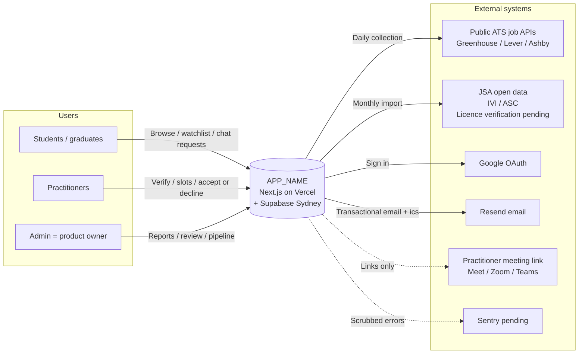
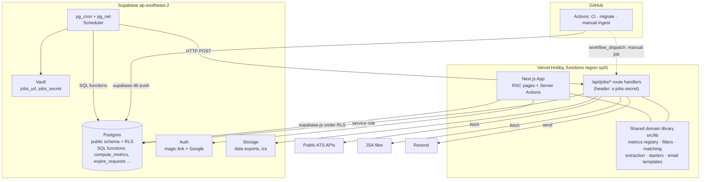
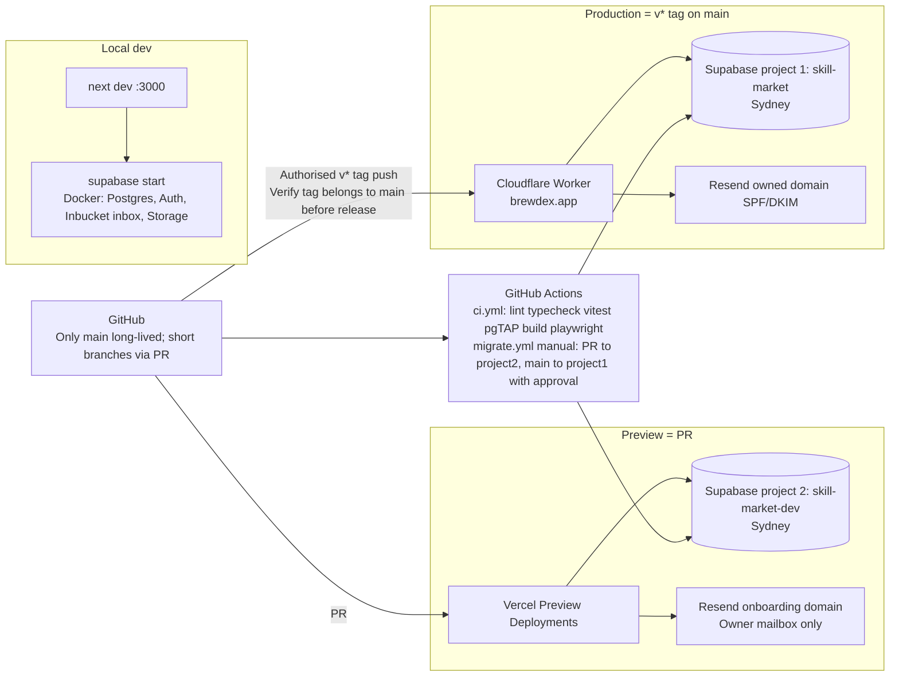
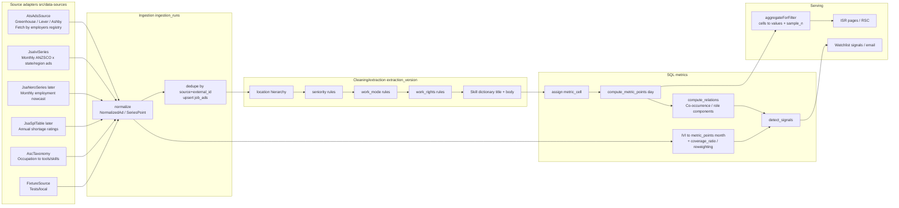
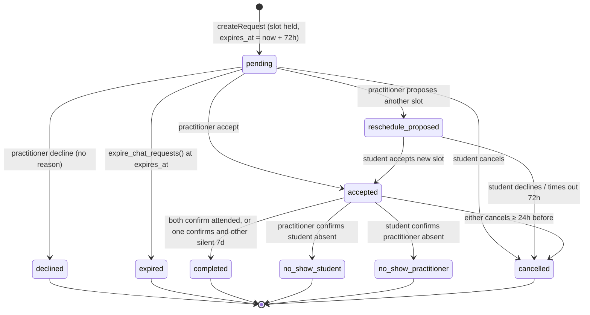

# ARCHITECTURE — `skill-market`

| Item | Details |
|---|---|
| Status | v0.2 — architecture approved; sources changed to ATS public APIs + JSA IVI calibration on 2026-10-23 |
| Basis | PRD v0.1, `docs/research/*`, agreed `CLAUDE.md` constraints |
| Maintainer | Main session; implementer/reviewer read only |
| Companion documents | MILESTONES (implementation order), PROGRESS (decisions/progress) |

> §1 is a one-page product-owner overview; §§2–11 guide implementers/reviewers; §12 records decisions made where the PRD was unclear. Read only sections relevant to the milestone, as indicated in MILESTONES.

---

## 1. One-page overview

**Product**: a trackable Australian labour-market board (skill / role instruments), using signals to match students with employed practitioners holding the skill for 20-minute coffee chats. Product name comes from `APP_NAME`.

**Ten core decisions**

| # | Decision | Rationale |
|---|---|---|
| A1 | Full-stack Next.js App Router: RSC public pages + Server Action writes, no separate API service | One free-tier runtime; built-in CSRF and type safety |
| A2 | Supabase `Postgres`/Auth/Storage/**pg_cron**; plain SQL migrations | Database RLS/scheduling survive hosting migration unchanged |
| A3 | Idempotent, shardable HTTP jobs (`/api/jobs/*`), scheduled by pg_cron + pg_net | Avoid proprietary Vercel Cron's daily-only Hobby schedule |
| A4 | **Ad-level storage + additive filter cells**: each ad has one location/`work_mode`/seniority/`work_rights` cell; metrics retain numerator/denominator and aggregate arbitrary rules exactly | Filters belong to watchlist entries; all combinations cannot be precomputed; cell aggregation is O(cells) |
| A5 | `AdsSource` adapters: initially Greenhouse/Lever/Ashby public ATS APIs for skills; `OfficialSeries`: JSA IVI roles/coverage, ASC/ANZSCO taxonomy, NERO/SPL later; fixture tests. Only these two source categories initially (user decision, 2026-10-23) | First-party employer jobs plus official totals for coverage/reweighting (§6.8) |
| A6 | One generated source for code/database metric registries: definition, units, denominator, types, sample minimum, windows | Make FR-D2 explanations and FR-M4 validity data-driven |
| A7 | **Deterministic** matching and starters; no MVP LLM | Explainable FR-C3, testable, no API costs |
| A8 | Explicit request state machine (`pending → accepted/declined/expired/...`); SQL timeouts, email outbox | Transactional, replayable quiet replacement for FR-C7/C8 |
| A9 | Owned Sydney analytics table, no external analytics SDK; Sentry pending | Minimise APP 8 cross-border transfers |
| A10 | Vitest TS + pgTAP RLS/SQL + Playwright journeys/axe | RLS needs database tests; half the core logic is SQL |

**PRD adjustments (§12; defaults applied, user may veto)**

- No skill `growth_12m` history at launch: use `change_4w` (latest versus previous four weeks) for MVP signals; enable growth after 12 accumulated months. Roles have IVI history from launch.
- `no_pr_required_share` means ads without an explicit PR/citizenship/full-work-rights requirement; explain that absence is not eligibility.
- Weekly availability templates generate four weeks of 20-minute slots; practitioners supply meeting links (Q2 default).
- `booking_enabled` gates supply; while disabled show waitlist/recruitment, not empty results.
- Age 18+ declaration records time/version, not birth date.

---

## 2. Technology choices

Agreed free-tier stack: Next.js TypeScript, Supabase ap-southeast-2, Vercel, Resend, GitHub Actions. Specific choices and rejected alternatives:

| Area | Choice | Rationale | Alternative | Rejection reason |
|---|---|---|---|---|
| Framework | Next.js 16 App Router/RSC/Actions/`proxy.ts`, React 19, Node 22 LTS, pnpm | Current stable; standalone portable to Node/containers | Pages Router | No RSC; client fetching harms LCP/cache |
| Data | **Supabase CLI SQL migrations** as schema source, generated types, `@supabase/ssr` / `supabase-js`; user RLS, job service role | One SQL definition for schema/RLS/cron/functions; strict generated types | Prisma | Direct/shadow DB, auth-schema conflicts, bypasses RLS, heavier cold starts |
| Validation | Zod for actions/env/jobs/adapters | One library/type inference | Valibot | Smaller ecosystem, less implementer familiarity |
| UI | Tailwind v4 + local shadcn/ui/Radix | Accessible, customisable, no runtime CSS-in-JS | MUI | Larger bundle, difficult theming/mobile LCP |
| Charts | Server SVG sparklines, **zero client JS**, + dynamically loaded **Recharts**, tables for all | Many sparklines; full charts need tooltips | Chart.js | Canvas lacks readable DOM; harder theme variables |
| Forms | Native form + Actions + `useActionState`, light client validation | Progressive enhancement, fewer abstractions | react-hook-form + tRPC | Two unnecessary client layers |
| i18n | Single-locale `next-intl`, no locale routes; `messages/en.json` | Central FR-A8 copy; add files/routes later | react-i18next | Client-oriented, weaker RSC |
| Email | Resend + React Email; Auth SMTP also Resend | One channel, previewable/testable templates | Default Supabase SMTP | Testing only, single-digit hourly quota |
| Jobs | **pg_cron** schedules, **pg_net** HTTP calls, SQL DB tasks | Free, Supabase-contained, hosting-independent | Vercel Cron | Hobby daily only, proprietary |
| Ingestion runtime | `/api/jobs/ingest-*` ticks < 50s, stored cursors; Actions manual fallback | One runtime; sharding avoids function limits | Scheduled Actions ingestion | Peak delays 15–30 min; 2,000 monthly minutes insufficient |
| Rate limits | `Postgres` table/`check_rate_limit()` | AU data, no supplier | Upstash Redis | Extra supplier/cross-border data |
| Error monitoring | Sentry EU, `sendDefaultPii=false`, scrub; **pending** | Free 5K/month, mature Next integration | No external monitoring | Incidents discovered only through users |
| Analytics | Owned `analytics_events`, SQL admin views | Small volume; stays Sydney | PostHog | US/EU free hosting, more disclosure |
| Logs | pino JSON stdout/Vercel Logs | Free, searchable fields | Axiom/Logtail | Extra supplier |
| Tests | Vitest, pgTAP, Chromium Playwright, axe | A10 | Jest | Complex ESM/TS, slower |
| Secret scans | gitleaks CI, Dependabot | No free private-repo push protection | GitHub Secret Protection | Paid |
| Calendar | Pure small ics package | Generates attachments | Google Calendar API | Extra OAuth scopes violate least privilege |

---

## 3. System diagrams

### 3.1 Context



### 3.2 Containers/components



### 3.3 Deployment/environments



Environment conventions:

| Environment | Code | Database | Email | Auth | Purpose |
|---|---|---|---|---|---|
| local | `next dev` | Docker Supabase | Inbucket | Local magic links; optional real Google client | Development, automated tests |
| preview | Vercel PR Preview | Sydney project 2 `skill-market-dev` | `onboarding@resend.dev` | Google Testing ≤ 100 users | Integration/usability tests |
| production | Cloudflare Worker, v* tag in main history | Sydney project 1 `skill-market` | Owned Resend domain | Google Production | Real users |

Two Supabase free projects cover prod/dev. Actions runs `supabase db push`; production uses the approval-gated production environment. Obtain separate authorisation for code merges and production database changes.

---

## 4. Frontend architecture

### 4.1 Routes and information architecture

> As of FE-R8, 2026-10-25: fully interactive prototype, synthetic market engine and browser localStorage demo backend (`src/lib/demo/store.ts`), no Supabase. Contract: FRONTEND_API_REPORT; design: DESIGN. This section records routes only.

```
/                                  307 → /market (preserve query, remove legacy ?f= in same hop); no separate homepage
/market?type=watching|all|skill|role|industry&metric=&layer=&q=
                                   Board; fixed All Australia / All levels / any work rights, no filters.
                                   Redirect removes legacy ?f=. Watching first, bookmark/count.
                                   Parameter-free visits always show opening (tagline/industry heatmap, DESIGN §4).
                                   Wordmark → /market top; Market nav → /market#board.
/s/[slug] · /r/[slug] · /i/[slug]  Skill/role/industry detail: one chart + Statistics.
                                   ?metric= drives Right now/chart; ?by= split (default none); ?f= filter.
                                   Title's "in …" opens filters.
/compare?a=<slug>&b=<slug>         Side-by-side comparison, maximum two
/search?q=                         Alias-normalised search
/metrics · /metrics/[key]          Metric definitions; full-page equivalent of ⓘ
/sources                           Sources/licences/extraction/errors/update times
/bot                               Collection scope/frequency/contact/opt-out, linked by User-Agent
/people                            Coffee-chat entry and practitioner recruitment
/onboarding                        Tier 0 → Tier 1, skippable
/me                                My desk: watchlist/signals/pending requests, merged with avatar menu
/me/skills · /me/gap?role= · /me/requests · /me/settings
/practitioner/join · /practitioner Registration/dashboard
/chat/new · /chat/[id]             Matching flow/request details
/admin · /admin/{reports,review,pipeline,metrics,taxonomy}
/legal/[doc]                       privacy · terms · conduct · reliability
/auth/login · /auth/callback · /auth/signout
/api/jobs/[job]                    POST x-jobs-secret background jobs, M1
/api/health                        DB health check/keepalive
```

Route groups `(public)`, `(student)`, `(practitioner)`, `(admin)` use layout auth guards; `proxy.ts` refreshes Supabase sessions only, without business decisions.

### 4.2 Core components

Phase-1 design below; actual names follow `src/components/`, `src/features/`, DESIGN §5. All copy from `messages/en.json` via `useTranslations`/`getTranslations`; inject `APP_NAME` through `src/config/app.ts`.

| Component | Description |
|---|---|
| `TickerRow` / `TickerCard` / `TickerPage` | Shared `InstrumentSnapshot` (value/change/sparkline/sample/source/update) and `TickerCore`; size determines visible fields |
| `ChangeBadge` | Relative and absolute values mandatory, `+38% (120 → 166 ads)`; icon/text/colour direction (NFR-3) |
| `MetricDefinitionPopover` | ⓘ registry definition/unit/denominator/window/geography/seniority/source/update/extraction/error |
| `SourceBadge` | Fixed official / ads / practitioner markers (FR-D5) |
| `MetricSwitcher` | Registry-valid instrument/window combinations, default/common/advanced groups |
| `FilterRuleBuilder` | Work mode + hierarchical location multiselect; progressively add rules; seniority/work rights alongside |
| `FilterReadback` | Testable pure `describeFilter` natural-language readback, FR-F3 |
| `SparklineSvg` | RSC inline SVG title/desc and hidden table |
| `TrendChart` | Client Recharts, `dynamic(() => import(...), { ssr: false })`, table toggle |
| `SampleWarning` | Replaces trend when `sample_n < min_sample`; broader-filter action |
| `CompositionList` | Clickable role components/weights, roles requiring skills, co-occurrence |
| `SkillProfileBoard` | Confirmed/suggested/next steps; confidence and one-click correction; no scores/ranks |
| `GapDiagnosis` | ≤ 3 priorities with relevance/entry suitability/transferability/effort |
| `CandidateCard` | Explainable reasons/topics/slots/entry path |
| `RequestStatus` | Reassuring pending copy; finding another person after timeout |
| `DebriefVote` | Three one-click options and optional one-line note |

### 4.3 Fetching and caching

| Pages | Rendering | Cache | Notes |
|---|---|---|---|
| Public board/detail/compare/definitions/sources | RSC, `export const revalidate = 3600`, post-pipeline `revalidateTag('market')` | Shared ISR | URL filters; common cache hits, long-tail on-demand caching |
| me/practitioner/chat/admin | Dynamic RSC via `cookies()` | None | User session/RLS |
| Writes | Server Actions | — | Zod → domain → `revalidatePath` |
| Search | RSC/`searchParams` | 60s ISR | In-memory alias prefixes, DB ilike fallback |

No Vercel KV/Blob/Edge Config/Edge Middleware APIs. ISR/`revalidateTag` are standard Next.js, supported by OpenNext Cloudflare and standalone.

### 4.4 Design system/accessibility

- Tailwind theme.css semantic up/down/flat/warn light/dark tokens; never colour-only direction.
- Self-hosted system-level sans via `next/font`; tabular-nums.
- 375px single-column core flows; ≥ 768px two columns.
- Radix keyboard/focus/ARIA; chart title/desc/tables; reduced-motion disables animations; ≥ 4.5:1 contrast; axe checks six key pages (§10).
- `ui_mode ∈ market | plain`, profile for signed-in users/cookie otherwise; terminology only (watchlist/tracking, ticker/card), two messages namespaces.
- Enforce UX structurally: `ChangeBadge` requires absolute values; `SkillProfileBoard` has no percentile prop; `RequestStatus` has no declined-by copy branch.

---

## 5. Backend architecture

### 5.1 Data model (ER)

```mermaid
erDiagram
    profiles ||--o| student_profiles : has
    profiles ||--o| practitioner_profiles : has
    profiles ||--o{ consents : records
    profiles ||--o{ watchlist_items : owns
    profiles ||--o{ student_skills : has
    profiles ||--o{ email_preferences : has

    instruments ||--o{ instrument_aliases : has
    instruments ||--o{ instrument_relations : from
    instruments ||--o{ metric_points : measured
    instruments ||--o{ watchlist_items : tracked
    instruments ||--o{ student_skills : skill
    instruments ||--o{ practitioner_skills : skill
    instruments ||--o{ job_ad_skills : tagged
    instruments ||--o{ course_unit_skills : maps

    metric_cells ||--o{ metric_points : cell
    locations ||--o{ metric_cells : location
    locations ||--o{ locations : parent
    metric_definitions ||--o{ metric_points : metric

    data_sources ||--o{ ingestion_runs : runs
    data_sources ||--o{ job_ads : from
    job_ads ||--o{ job_ad_skills : has
    locations ||--o{ job_ads : located

    universities ||--o{ course_units : offers
    course_units ||--o{ course_unit_skills : implies

    practitioner_profiles ||--o{ practitioner_skills : holds
    practitioner_profiles ||--o{ practitioner_topics : offers
    practitioner_profiles ||--o{ availability_templates : weekly
    practitioner_profiles ||--o{ availability_slots : generated
    practitioner_profiles ||--o{ work_email_verifications : verifies

    watchlist_items ||--o{ signals : triggers
    signals ||--o{ chat_requests : context
    availability_slots ||--o| chat_requests : booked
    chat_requests ||--o{ chat_request_events : audit
    chat_requests ||--o| debrief_votes : L0
    chat_requests ||--o{ attendance_confirmations : L2
    chat_requests ||--o{ reports : about
    profiles ||--o{ reliability_records : has
    profiles ||--o{ notifications_outbox : to
    profiles ||--o{ blocks : blocker
    profiles ||--o{ waitlist_entries : waits
    profiles ||--o| account_deletions : requested
    profiles ||--o{ data_exports : requested

    profiles {
        uuid id PK
        text display_name
        text timezone
        text ui_mode
        boolean is_admin
        timestamptz created_at
        timestamptz deleted_at
    }
    student_profiles {
        uuid user_id PK
        uuid university_id
        text degree
        smallint study_year
        text visa_status_optional
        jsonb field_visibility
    }
    practitioner_profiles {
        uuid user_id PK
        smallint entry_year
        uuid current_role_instrument_id
        text industry
        text work_email_domain
        text verification_status
        smallint monthly_cap
        boolean paused
        text meeting_link
        text intro_path
    }
    instruments {
        uuid id PK
        text instrument_type
        text slug
        text name
        text anzsco_code
        text status
    }
    instrument_relations {
        uuid from_id FK
        uuid to_id FK
        text relation
        numeric weight
        text source
        timestamptz computed_at
    }
    locations {
        uuid id PK
        text kind
        uuid parent_id
        text name
        text jsa_code
    }
    metric_cells {
        uuid id PK
        uuid location_id FK
        text work_mode
        text seniority
        text work_rights
    }
    metric_definitions {
        text key PK
        text name
        text definition
        text unit
        text denominator
        text[] applicable_types
        text tier
        int min_sample
        text source_kind
        int available_after_days
    }
    metric_points {
        uuid instrument_id FK
        uuid cell_id FK
        text metric_key FK
        text period
        date period_start
        numeric numerator
        numeric denominator
        int sample_n
        text source_key
        timestamptz computed_at
    }
    job_ads {
        uuid id PK
        text source_key FK
        text external_id
        text title
        text company_name
        uuid location_id FK
        text work_mode
        text seniority
        text work_rights
        numeric salary_min
        numeric salary_max
        text contract_type
        date posted_at
        text raw_snippet
        smallint extraction_version
    }
    watchlist_items {
        uuid id PK
        uuid user_id FK
        uuid instrument_id FK
        text status
        jsonb filter
        text filter_hash
        text metric_key
        numeric baseline_value
        timestamptz baseline_at
    }
    signals {
        uuid id PK
        uuid instrument_id FK
        uuid watchlist_item_id FK
        text metric_key
        text kind
        numeric from_value
        numeric to_value
        int sample_n
        timestamptz detected_at
    }
    chat_requests {
        uuid id PK
        uuid student_id FK
        uuid practitioner_id FK
        uuid slot_id FK
        uuid signal_id
        uuid instrument_id FK
        jsonb filter_snapshot
        text decision_question
        jsonb starters
        jsonb student_visible_fields
        text status
        timestamptz expires_at
        timestamptz responded_at
    }
    availability_slots {
        uuid id PK
        uuid practitioner_id FK
        timestamptz start_at
        timestamptz end_at
        text status
    }
    notifications_outbox {
        uuid id PK
        uuid to_user_id FK
        text template
        jsonb payload
        timestamptz scheduled_at
        timestamptz sent_at
        text status
        int attempts
    }
```

**Design notes**

- `instruments.instrument_type` enum: `skill | role | industry | employer | credential`; MVP writes first two only. Registry filters reserved types; adding types needs no schema change (FR-D7).
- Relations: `role_has_skill` weighted from ASC tools + ad co-occurrence; `skill_cooccurs` weight = co-occurrence rate; `skill_adjacent` derived for matching fallback.
- Watchlist filter is `FilterSpec` JSON (§6.3), `filter_hash` its normalised hash; baseline records value at addition (FR-W2).
- Request `student_visible_fields` snapshots permitted fields at sending (FR-C11); practitioners read this, never `student_profiles`.
- Optional sensitive student columns (visa etc.) default to self-only visibility; split into `student_sensitive` if needed later.
- All times timestamptz; both users store IANA time zones, with locally displayed slots.
- Soft deletion immediately anonymises display; `purge_after = now() + 30 days`; cron physically deletes on expiry (FR-A5).

### 5.2 API / Server Actions overview

Writes are Server Actions under `src/actions/*.ts`, one domain/file, Zod inputs, `Result<T, FormError>` outputs. RSC reads directly. Only three handler categories: jobs, health, auth callback.

| Domain | Actions | Rules |
|---|---|---|
| onboarding | `completeTier0(university, degree, year)`, `completeTier1(unitCodes[])`, `skipOnboarding()` | Anonymous Tier 0 cookie, merged after sign-in |
| skills | `confirmSkill`, `removeSkill`, `addSkill` | inferred → confirmed; removal is hard deletion, no rejection record for scoring |
| watchlist | `addWatchlistItem(instrument, filter, status)`, `updateFilter`, remove | baseline = current metric |
| gap | No writes; pure read/functions | |
| practitioner | `joinAsPractitioner`, `sendWorkEmailCode`, `verifyWorkEmailCode`, `updateAvailabilityTemplate`, `setPaused`, `updateCap` | Six-digit hashed code, ten-minute expiry, three/hour |
| chat | `findCandidates(instrument, filter, signal?)` (read), `createRequest`, `acceptRequest`, `declineRequest`, `proposeReschedule`, `acceptReschedule`, `cancelRequest`, `confirmAttendance`, `submitDebrief` | §7.2 state machine; event/outbox every step |
| privacy | `updateFieldVisibility`, `updateEmailPreferences`, `requestExport`, `requestDeletion` | Storage JSON, 24h signed URL |
| safety | `reportUser`, `blockUser` | Exclude blocked candidates |
| admin | `resolveReport`, `suspendUser`, `approvePractitioner`, `rejectPractitioner`, `rerunJob`, `upsertAlias` | `is_admin` only |

POST jobs compare `x-jobs-secret` in constant time, acquire `job_runs` lease (reject running/unexpired lease), execute ≤ 50s shard, persist cursor/stats, return `{ done: boolean }`. Cron calls at fixed intervals until done.

### 5.3 Authentication, authorisation, RLS

- Supabase magic links default, plus Google; no passwords (reduces credential exposure; FR-A1 allows either).
- `@supabase/ssr` cookies, `proxy.ts` refresh.
- No custom JWT claims: security-definer `is_admin()` / `is_verified_practitioner()` read profiles; RLS and app guards use the same functions.
- Service-role key only in job/CI environments, never client bundles. Zod server/client groups; client allows `NEXT_PUBLIC_*` only.

RLS matrix: anon = signed out, auth = authenticated owner, pract = verified practitioner, admin, svc = service role.

| Table | select | insert | update | delete |
|---|---|---|---|---|
| instruments, `instrument_aliases`, `instrument_relations`, locations, `metric_cells`, `metric_definitions`, `metric_points`, `data_sources`, universities, `course_units`, `course_unit_skills` | anon, auth | svc, admin(taxonomy) | svc, admin(taxonomy) | svc |
| `job_ads`, `job_ad_skills`, `ingestion_runs`, `job_runs` | admin | svc | svc | svc |
| profiles | Owner/admin | Owner via auth.users trigger | Owner excluding `is_admin`; admin | svc purge |
| `student_profiles`, `student_skills`, `watchlist_items`, `email_preferences`, consents | Owner/admin | Owner | Owner | Owner |
| signals | Owner via watchlist; global watchlist_item_id null visible to anon | svc | svc | svc |
| `practitioner_profiles` | Owner/admin; auth via public `practitioner_cards`, verified/unpaused/non-sensitive columns only | Owner | Owner excluding `verification_status`; admin | Owner |
| `practitioner_skills`, `practitioner_topics`, `availability_templates` | Owner; auth via `practitioner_cards` | Owner | Owner | Owner |
| `availability_slots` | Owner; open slots for auth | Owner, svc | Owner, svc | Owner, svc |
| `work_email_verifications` | Owner, status only | svc | svc | svc |
| `chat_requests` | Student or practitioner owner; admin | Student via action validating slot/cap/blocks | Party-specific transitions enforced by `transition_chat_request` | None |
| `chat_request_events`, `attendance_confirmations` | Both parties | Both, restricted columns | None | None |
| `debrief_votes` | Student owner | Student owner | Student owner | Student owner |
| `reliability_records` | Admin only | svc | svc | svc |
| reports | Reporter owns; admin | auth | admin | None |
| blocks | Owner | Owner | None | Owner |
| `notifications_outbox`, `rate_limits`, `analytics_events`, `feature_flags`(write) | svc / admin | svc | svc | svc |
| `feature_flags`(read) | anon | — | — | — |
| `account_deletions`, `data_exports` | Owner | Owner | svc | svc |

Enable RLS on every table; positive/negative pgTAP cases per policy in `supabase/tests/rls_*.sql`. `practitioner_cards` uses `security_invoker = false`, explicit columns, no email information beyond `work_email_domain`.

### 5.4 Jobs/scheduling

Each src/jobs/name.ts exports `run(ctx): Promise<{ done: boolean; stats }>`; registry lists names/default cron/timeouts. DB tasks run SQL directly; network tasks receive pg_net POSTs.

| Job | Type | Cadence (pg_cron, AEST) | Details |
|---|---|---|---|
| `poll-ats` | HTTP shards | Hourly, staggered | Lightweight IDs/title/update lists without body; employer activity determines due polls (§6.7); enqueue new IDs, close missing IDs |
| `fetch-ats-details` | HTTP shards | After polling | Fetch/deduplicate new IDs only |
| `extract-features` | SQL + TS | After details | Seniority/mode/rights/dictionary over title/body; strip names/email/phone; `extraction_version` |
| `compute-metrics` | `compute_metric_points(date)` SQL | Daily 04:00 | Cell × instrument × metric, daily; monthly IVI imports |
| `compute-relations` | SQL | Sunday | Recalculate co-occurrence/components |
| `detect-signals` | `detect_signals()` SQL | Daily 04:30 | Watchlist/global cells, §6.5 thresholds, outbox if alerts enabled |
| `ingest-jsa` | HTTP shards | First of month/manual | IVI monthly points; NERO/SPL later |
| `compute-coverage` | SQL | After JSA | ANZSCO4 × state × month coverage/reweighting (§6.8) |
| `expire-requests` | `expire_chat_requests()` SQL | Every 15 min | Expired pending → expired; release slots; finding-someone-else outbox |
| `generate-slots` | SQL | Daily | Generate 28 days; expire unbooked past slots |
| `schedule-reminders` | SQL | Hourly | Accepted within 24h: both-party reminders/ics/preparation; +1h after end: L0/L2 |
| `dispatch-outbox` | HTTP | Every 5 min | Due queued records, Resend, exponential backoff ≤ 5 retries; defer beyond 100/day |
| purge | SQL | Daily | Expired accounts, raw snippets > 30d, analytics detail > 90d, retain aggregates |
| `health-keepalive` | External | Every 5 min, free monitoring, SETUP §7 | Health DB query prevents seven-day Supabase idle pause |

Schedules live in migrations; URL/secret read from Vault decrypted_secrets. Local jobs run via `pnpm job <name>`.

---

## 6. Data pipeline and policy

### 6.1 Pipeline



### 6.2 Sources/licensing

| Source | Content | Granularity | History | Licence/commercial use | Purpose | Status |
|---|---|---|---|---|---|---|
| Greenhouse/Lever/Ashby public ATS APIs | Title/employer/location/department/body/application link; some salaries | Ads → skills | Active jobs only; build history from collection start | Public unauthenticated documentation; **no explicit licence or prohibition**, see below | Skill counts, entry/remote/rights/employers/salaries, own snapshots | Initial primary |
| JSA IVI | Monthly online ads, SEEK/CareerOne/Workforce Australia; ANZSCO4 × state/SA4 | Roles | Since 2006 | JSA publications generally CC BY 4.0; **data.gov.au IVI says Not Specified**; written confirmation needed | Role ads/growth history, coverage denominator/reweighting, later seasonality | Initial official primary |
| JSA NERO | Monthly employment nowcast, 355 occupations × 88 regions | Roles | Since 2015 | CC BY 4.0, recheck | Regional employment fundamentals | Later |
| JSA SPL | Shortage ratings | Roles | Annual | CC BY 4.0, recheck | National shortage yes/no | Later |
| ASC | Occupation → tools/tasks/core competencies | Role/skill map | Versioned | CC BY 4.0, recheck | Component priors, dictionary seeds | Recheck |
| ABS ANZSCO | Occupations | — | — | CC BY 4.0 | Role anzsco_code | Recheck |
| University catalogue | Unit code/name | — | — | Manually compile public facts; no scraping | Tier 1/inference | Assumption |
| Simple Icons npm, bundled not CDN | Monochrome SVG technology/tool logos | Explicit skill mapping `src/lib/market/logos.ts` | — | CC0 1.0 set; owner trademarks, nominative identification only | Symbol boxes | In use |
| Platform-owned | Votes/matches/attendance | — | Since launch | Owned | Later sentiment, internal reliability | — |

**Attribution**: sources page and `SourceBadge` popovers use `data_sources.attribution` text/licence links, never hardcode.

**Retention**: `raw_snippet` retained 30 days for re-extraction, then purge; long-term derived fields/aggregates only. Where terms forbid content storage, source retention = 0 days and extraction occurs within ingestion transaction, without changing code paths. Strip recruiter names/email/phone before storage (APP 3).

**Official-term verification, 2026-10-23**

| Source | Documentation | Conclusion |
|---|---|---|
| Greenhouse | Public GET/no auth, for employer career sites; no use/cache/commercial terms | Neither prohibited nor authorised |
| Lever | For building job sites; published postings may be scraped by third parties; no licence | Acknowledges third parties, not authorisation |
| Ashby | Own-organisation postings for career sites; no terms/rate/commercial details | Neither prohibited nor authorised |
| Workday | Internal career-page JSON only, no public API | **Exclude**, equivalent to scraping |
| Workable/SmartRecruiters/Recruitee | Unofficial Workable widget only; no terms found for others | Exclude initially; verify later |
| JSA IVI | Dataset licence unspecified | Written confirmation needed |

Mitigation (§6.7): no republication, derived fields/counts only, raw text purged after 30d, remove personal information, polite collection, remove employers on opt-out. Before commercialisation obtain vendor/JSA written responses and Australian legal review of sources/copyright/privacy (SETUP §6).

**Excluded initially**: Adzuna free API prohibits ongoing commercial aggregate counts/salaries without written consent; never scrape LinkedIn/SEEK/Indeed. See data-sources research.

### 6.3 Filters: `FilterSpec` and cells

```ts
type WorkMode = 'onsite' | 'hybrid' | 'remote';
type FilterSpec = {
  rules: Array<{ work_modes: WorkMode[]; location_ids: string[] }>; // Union of rules
  seniority: 'entry' | 'graduate' | 'all';        // entry ⊇ graduate + junior + intern
  work_rights: 'no_pr_required' | 'all';
};
```

- Each extracted ad gets **one** `(leaf_location_id, work_mode, seniority_bucket, work_rights_bucket)` cell. Unknown mode defaults onsite (§12); seniority graduate/entry_other/other; rights `requires_pr`/not_stated/`sponsorship_ok`.
- Points store numerator/denominator/`sample_n` per cell. `expandFilterToCells()` expands location leaves and deduplicates rule unions; sums give exact arbitrary-filter results in watchlists. **Pure tests verify additivity.**
- Non-additive salary median/percentiles query ≤ 12 months of `job_ads` with `percentile_cont` over expanded cells instead.
- Sum samples; below configurable default 30 returns `insufficient_sample`; no trend (FR-D4).
- `describeFilter(spec, locations)` uses the same tree for natural-language readback (FR-F3).

### 6.4 MVP metric registry

| `metric_key` | Definition (plain wording in messages) | Numerator/denominator | Types | Tier | Availability |
|---|---|---|---|---|---|
| `ad_count` | Matching ads in window | count / — | skill, role | Common | Any data |
| `share_of_ads` | Skill/role ads divided by all filtered ads | skill ads / all cell ads | skill default, role | Common | Any data |
| `change_4w` | Latest versus previous four weeks, with absolute counts | — | skill, role | Common, MVP signal | ≥ 56 days |
| `growth_12m` | Latest versus previous 12 months | — | skill, role default via IVI | Common | Skills ≥ 730 own days; roles IVI |
| `entry_level_share` | Entry/graduate ads | entry / all | skill, role | Common | Any data |
| `no_pr_required_share` | No explicit PR/citizenship/full-rights requirement | not_stated + `sponsorship_ok` / all | skill, role | Common | Data; extraction/error popover |
| `employer_concentration` | Distinct employers and top-five share | distinct companies; top5 / all | skill, role | Common | Data |
| `salary_median` | Disclosed salaries only; explain coverage | — | skill, role; skills since 2026-10-17, GLOSSARY §3 | Common | Disclosed n ≥ minimum |
| `salary_p10_p90` | 10th–90th salary percentiles | — | role | Advanced | Same |
| `remote_share` | Remote/hybrid ads | remote+hybrid / all | skill, role | Advanced | Data |
| `contract_share` | Contract ads | contract / all | skill, role | Advanced | Data |
| `skills_per_ad` | Median identified skills per ad | — | role | Advanced | Data |
| volatility | Weekly ad-count coefficient of variation, 12 weeks | — | skill, role | Advanced | ≥ 84 days |
| `skill_premium` | Within-role salary median with versus without skill | — | skill | Advanced | Salary n ≥ 2 × minimum |
| `coverage_ratio` | Observed new ads / IVI same occupation/state (§6.8) | ours / IVI | skill, role | Definition popover | IVI imported |
| `nero_employment` | Official regional employment nowcast | — | role | Later fundamentals | NERO |
| `spl_shortage` | Official national shortage rating | — | role | Later fundamentals | SPL |

Registry in `src/lib/metrics/registry.ts` generates migration `metric_definitions` via `pnpm metrics:sync`; CI checks consistency. Selector and definition popover read registry only.

### 6.5 MVP signals

`detect_signals()` evaluates each watchlist item's filter/metric and each instrument's global default cells (AU/all modes/all):

| kind | Condition | Notes |
|---|---|---|
| rise | `change_4w ≥ +25%`, absolute increase ≥ 10, sample ≥ minimum | Configurable `feature_flags.signal_thresholds` |
| fall | `change_4w ≤ −25%`, absolute decrease ≥ 10 | Same; neutral "fewer ads than 4 weeks ago" |
| `entry_open` | Entry share rises ≥ 10 percentage points versus eight weeks ago | Most actionable for students |
| `since_added` | ≥ 25% change from watchlist baseline | Watchlist only, no email |

**After real data**: postings are low-frequency Poisson arrivals. Replace fixed 25%/10 thresholds with a Poisson test of random fluctuation: avoid noisy small skills and missed large-skill changes. Threshold configuration remains in `feature_flags.signal_thresholds`.

Signals always include absolute values (FR-D3) and sufficient samples. `signal_id` is optional on requests, but chat UI always carries instrument/filter; signal is extra context.

### 6.6 Skill dictionary/extraction

- ~150 launch software/data skill seeds from ASC tools/manual curation, aliases JS/`Javascript` → JavaScript, `Postgres` → PostgreSQL. Versioned `supabase/seed/skills.yaml` via `pnpm seed`.
- ~25 ANZSCO6 roles: Software Engineer 261313, Data Engineer, Analyst Programmer etc.; ASC component priors, recomputed after eight weeks of co-occurrence, with source labels.
- src/lib/extraction rules have version/precision/recall on 200 manually labelled prelaunch ads; publish results on sources. Example seniority: `graduate|grad program|junior|entry level|intern` without `senior|lead|principal|manager|head of`; rights: `must have (full )?working rights|australian citizen|permanent resident|pr or citizen|no sponsorship` → `requires_pr`; `sponsorship available|482` → `sponsorship_ok`.
- ATS body + title dictionary matching, `job_ad_skills.method = 'dictionary'`; fixtures use identical paths.

### 6.7 Building snapshots (PRD §11)

1. **Day one**: daily production collection after M1, before UI launch, yielding weeks of skill history.
2. **Roles before skills**: IVI monthly role history at launch; skills show tracking_since/`change_4w`; registry `available_after_days` enables growth later.
3. **Cold start**: initial active jobs form baseline; closed ATS history is unavailable, so skill history starts at collection.
4. **Cadence**: daily metric settlement; two ingestion layers, employer-based rather than skill-based because one employer request returns all jobs:
   - **Light polling** hourly IDs/title/update; fetch details only for new IDs. Greenhouse supports no-body lists; verify Lever/Ashby in M1, otherwise fetch full payload but process new IDs only.
   - **Adaptive cadence**: estimate employer Poisson λ over eight weeks in post_rate. Busy employers (dozens/week) hourly, quiet ones (one/month) daily. New employers hourly for two weeks, then adapt. Most hourly changes come from a few large employers, reducing requests.
   - **Politeness**: stagger, no top-of-hour burst; robots.txt, 429 backoff, identifiable `ATS_USER_AGENT` such as `<APP_NAME>-bot/0.1 (+https://brewdex.app/bot; <contact email>)`. Bot page explains collection/contact/opt-out.
   - **Intraday layer** answers what happened today: real ticker events ("Atlassian posted 3 Data Engineer jobs · 2 h ago") and instrument new-today counts. No intraday metric recomputation. Update times everywhere (DESIGN §8).
5. **Storage**: ~300 B derived fields/ad; 100–200K annual launch-category ads < 60 MB, below 500 MB.
6. **Replaceability**: no vendor-specific fields in `AdsSource`. Future licensed sources implement/register adapters. User negotiates paid Adzuna/Indeed/ATS partnerships after customers; Employment Hero preferred for SMEs.

### 6.8 Coverage/reweighting (official calibration)

ATS sources favour medium/large employers and undercount construction, retail, care, and other SME-heavy industries. Initial IVI benchmark:

- Registry `employers(name, abn?, ats, board_token, anzsic, size_band, post_rate, next_poll_at, verified_at)` manually seeded from ASX200, Big Four, banks, universities, government, Australian technology firms; record ATS/public endpoints.
- Deduplicate `(employer, normalized_title, location, description hash)` across channels.
- Coverage = deduplicated new ads / IVI new ads per ANZSCO4/state/month. IVI covers only three boards, so approximate relative coverage, not sampling rate. Skill coverage weights its main occupations.
- Post-stratify skill share by IVI occupation/state weights, correcting large-employer/tech bias. Cannot observe within-occupation SME/large-firm differences (Xero/SAP); disclose in definitions.
- Calibrate real thresholds: ≥ 40% normal, 15–40% note beside value, < 15% or thin sample suppress changes/signals, "Not enough coverage yet".
- Registry coverage metric (§6.4), definitions/sources behind ⓘ.

---
## 7. Matching and coffee chats

### 7.1 Deterministic, explainable matching

Inputs: `instrument_id`, `FilterSpec`, optional `signal_id`, student `user_id`.

1. **Hard filters**: verified/unpaused `practitioner_cards`; neither party blocks the other; accepted monthly count below cap; ≥ 1 open slot at least 48h away; no reliability suspension.
2. **Skills**: holds skill; for roles, holds ≥ 2 top-weight components or currently works in that role.
3. **Scoring**, each factor maps to a reason:

| Factor | Points | Reason template |
|---|---|---|
| Exact skill | +40 | Uses {skill} in their current role |
| Entered 1–3 years ago | +25; 4–6 years +10 | Entered the industry {n} years ago |
| Current role is a top role for skill | +15 | Works as a {role}, one of the roles that most often asks for {skill} |
| Topic overlaps question keywords | +10 | Happy to talk about {topic} |
| Same filtered state | +10 | Based in {city} |
| Accepted monthly requests, load balancing | −5 × n | Not displayed |

4. Top three; if fewer, use `skill_adjacent` co-occurrence ≥ 0.3 and label Related skill. If still empty, show `waitlist_entries`/recruitment; never a zero-results dead end.
5. `generateStarters(signal, instrument, decisionQuestion, practitioner)` fills ~15 `src/lib/starters/templates.ts` templates, returns three editable starters. No LLM.

### 7.2 Request state machine



All transitions use SQL `transition_chat_request(request_id, event, actor)` to validate actor/state, write events, update held → booked/open slots, and enqueue outbox. Declined/expired both appear as still looking with immediate alternatives (FR-C7/C8). Do not calculate/store displayable reply rates.

Internal reliability: ≥ 2 no-shows within 30 days suspends matching (practitioners) or requests (students) for 30 days. Publish rules at legal/reliability, never student scores.

### 7.3 Sequence diagrams

**Tier 0 onboarding: anonymous → personalised board**

```mermaid
sequenceDiagram
    actor S as Student
    participant W as Next.js RSC / Action
    participant DB as Supabase (RLS)
    S->>W: GET /onboarding
    W-->>S: University, degree, year; skippable
    S->>W: completeTier0(university, degree, year)
    W->>DB: select course_unit_skills / degree_skill_priors
    DB-->>W: Inferred skills + confidence
    W-->>S: Cookie onboarding_draft; 302 to /market?personalised=1
    Note over S,W: Sort by inferred skills, Suggested labels, one-click confirm/remove
    S->>W: Optional magic link / Google sign-in
    W->>DB: Merge cookie into student_profiles/student_skills(source=inferred)
    S->>W: Optional completeTier1(unitCodes)
    W->>DB: upsert student_skills(source=inferred, evidence=unit)
```

**Signal → matching → request → timeout/decline**

```mermaid
sequenceDiagram
    actor S as Student
    participant W as Next.js
    participant DB as Supabase
    participant CR as pg_cron
    participant O as outbox → Resend
    actor P as Practitioner
    CR->>DB: detect_signals() daily
    DB-->>S: /me highlights Rust · Sydney entry-level · +38% (120 → 166)
    S->>W: Talk to someone who uses Rust
    W->>DB: findCandidates(instrument, filter, signal)
    DB-->>W: At most three candidates + factors
    W-->>S: Three cards with reasons/topics/slots and three starters
    S->>W: createRequest(practitioner, slot, decisionQuestion, starters, visibleFields)
    W->>DB: transition(pending); slot held; outbox(request_received → P)
    O-->>P: Who, signal, question, 20 minutes, accept/reschedule/decline
    alt Accept
        P->>W: acceptRequest
        W->>DB: transition(accepted); slot booked; accepted email to S, ics to both
        CR->>DB: schedule_reminders() 24h before
        O-->>S: Reminder, preparation, meeting link
        O-->>P: Reminder
    else Decline
        P->>W: declineRequest
        W->>DB: transition(declined); slot open; still_looking to S
        W-->>S: Immediate alternatives, neutral copy
    else No reply for 72h
        CR->>DB: expire_chat_requests()
        DB->>DB: transition(expired); slot open; still_looking to S
        O-->>S: We're finding someone else for you + candidate link
    end
```

**Debrief/attendance**

```mermaid
sequenceDiagram
    participant CR as pg_cron
    participant DB as Supabase
    participant O as outbox → Resend
    actor S as Student
    actor P as Practitioner
    participant W as Next.js
    CR->>DB: schedule_reminders() slot end +1h
    DB->>O: debrief_l0 to S, attendance_l2 to P
    O-->>S: Did the chat change how you feel about Rust? Three buttons
    O-->>P: Did the chat happen? Two buttons
    S->>W: submitDebrief(vote, note?)
    W->>DB: insert debrief_votes; student attendance
    P->>W: confirmAttendance(happened | no_show)
    W->>DB: practitioner attendance; transition(completed | no_show_*)
    DB->>DB: Internal reliability_records
    W-->>S: /s/rust personal record, date and more interested
```

---

## 8. Security, privacy, observability

### 8.1 Security

| Surface | Measures |
|---|---|
| Authentication | Supabase; single-use 15 min magic links; Google openid/email/profile only |
| Authorisation | RLS final boundary (§5.3); app guards UX only; SQL transitions |
| Input | Zod for every action/job; no rich text; escaped plain questions/notes |
| Secrets | Grouped env validation; service role jobs/CI only; constant-time job secret; Vault pg_net secrets; gitleaks |
| Rate limits | `check_rate_limit`: student requests 5/day, codes 3/hour/user, reports 10/day, exports 1/day, anonymous hashed-IP search 120/min |
| Headers | CSP default-src self, nonce chart inline styles; HSTS; X-Frame-Options DENY; strict-origin-when-cross-origin referrer |
| Dependencies | Weekly Dependabot; CI `pnpm audit --prod` fails high+ |
| Abuse | Work-email verification, free/disposable domain denylists; unverified cards excluded; admin suspension after reports |
| Backups | Free Supabase has no PITR; daily schema/non-personal `pg_dump` Actions artifact, 30d retention; weekly encrypted full dump to private AU Storage. Strength pending approval |

### 8.2 Privacy Act 1988 / APPs

| APP | Requirement | Implementation |
|---|---|---|
| APP 1 | Transparent public policy | privacy page lists collection/purposes/recipients Vercel, Resend, Google, Sentry/retention/complaints |
| APP 3 | Necessity, sensitive-data consent | Required email/18+ only; optional visa fields explain purpose; consents table |
| APP 5 | Collection notice | Field helper text explains purpose/visibility |
| APP 6 | Purpose-limited disclosure | Practitioner visibility snapshot only; no employer data access |
| APP 8 | Cross-border disclosure | DB/Storage Sydney, functions `syd1`, edge CDN transit; disclose Resend/Google/Sentry |
| APP 11 | Security/destruction | RLS/TLS/default encryption; 30d deletion/raw snippets |
| APP 12 / 13 | Access/correction | Settings JSON export; editable profile fields |
| NDB | Notifiable breaches | M8 runbooks/breach.md: determine, assess within 30d, notify OAIC/users |

Minimisation: no birth dates, no raw IP (hash for limits), no free text/email in analytics; scrub email/`decision_question`/note from logs.

### 8.3 Observability

- **Errors**: Sentry pending; minimum pino errors + admin failed jobs.
- **Jobs**: `job_runs` tick start/end/stats/errors; `ingestion_runs` per-source records/deduplication/calls/coverage; two consecutive failures email admin via outbox (FR-X3).
- **Events**: server `track(name, props)` to `analytics_events`: `market_viewed`, `instrument_viewed`, `metric_switched`, `filter_changed`, `definition_opened`, `onboarding_tier0_completed`, `onboarding_tier1_completed`, `skill_confirmed`, `skill_removed`, `watchlist_added`, `find_people_clicked`, `request_sent`, `request_accepted`, `chat_completed`, `debrief_voted`. Admin SQL activation/matching/attendance/North Star (FR-X4).
- **Health**: DB reachability, last metric run, outbox backlog; external five-minute checks.
- **Performance**: mobile Lighthouse on three preview pages; LCP > 2.5s warning, blocking from M8.

---

## 9. Testing

| Layer | Tool | Coverage | Command |
|---|---|---|---|
| Unit | Vitest | Filter expansion/aggregation/readback, registry validity, extraction/labelled regressions, matching/scoring/fallback, starters, pure state machine, changes, env | `pnpm test:unit` |
| DB | pgTAP via Supabase | Positive/negative RLS, fixture metric values, illegal expiry/transitions, rate limits, purge scope | `pnpm test:db` |
| Integration | Vitest + local Supabase | Idempotent ticks, mocked Resend, complete fixture pipeline | `pnpm test:integration` |
| E2E | Chromium Playwright, 375/1280px | Anonymous board/detail/metric/filter; onboarding/login/Inbucket/watchlist; practitioner verification/slots; request/accept/debrief; admin reports | `pnpm test:e2e` |
| Accessibility | axe | Zero serious/critical on /, `/market`, `/s/[slug]`, `/compare`, `/onboarding`, `/chat/new` | Within E2E |
| One-command | lint/typecheck/unit/db/build | Milestone baseline | `pnpm verify` |

Seeds `supabase/seed/*.sql` and ~500 synthetic `fixtures/ads/*.json` cover cells/rule boundaries. Dedicated E2E users `student@test.local`, `pract@test.local`, `admin@test.local`.

---

## 10. CI/CD

```
.github/workflows/
  ci.yml        PR and push(main, m*-*): install → gitleaks → lint → typecheck → unit → supabase start → db reset → db → integration → build → e2e against next start → upload Playwright report
  migrate.yml   manual: any branch → project2 db push; main → approved production environment → project1 push → /api/jobs/health
  deploy-cloudflare.yml  v* push → lint → typecheck → unit → OpenNext build → verify main ancestry → brewdex.app; manual validates only, see CLOUDFLARE_DEPLOYMENT
  ingest.yml    manual fallback for any job
  backup.yml    daily schema/public-data dump artifact
```

- Only main long-lived; short branches/PR/integration, authorised v* push releases. Vercel Git provides PR previews; main `*.vercel.app` is not production. Vercel builds `next build` only; tests in Actions.
- Main protection: CI plus one user approval.
- Conventional commits; M8 generates CHANGELOG before launch.
- User/Codex maintain env.example; main session proposes §12 additions in PROGRESS.

---

## 11. Free-tier limits

| Service | Allowance, verify officially | First limit | Estimated scale | Next step |
|---|---|---|---|---|
| Supabase | 500MB DB, 1GB Storage, 50K MAU, 5GB monthly egress, two projects, seven-day idle pause, no PITR | DB derived ads/points | 3–4 years launch category; ~1 year with five; MAU unlikely first | Pro USD25/month 8GB, optional PITR; or retain ads 12 months |
| Vercel Hobby | 100GB bandwidth, GB-hour functions, one region, **no commercial use** | Terms | At launch | Pro USD20/month or OpenNext Cloudflare free 100K requests/day, standalone Fly/Railway; zero business-code change target |
| Resend | 3K/month, 100/day, one domain | Daily | ~7 emails/chat, ~14 daily loops or 300 active users | USD20/month 50K; quota queue prevents loss |
| Actions | Private 2K min/month | CI, ~3 min Supabase startup | ~150 runs/month | Nightly e2e or public repo unlimited minutes |
| Google | Testing 100 users | Users | Before launch | Domain/privacy policy → free Production |
| ATS APIs | No published read limit | Employers × cadence | 2K hourly = 48K/day, <1/s; adaptive much lower | Lightweight/adaptive, 429 backoff |
| Sentry optional | 5K errors/month | Error storm | One frontend storm | Sampling/ignores; Team USD26/month |
| pg_cron / pg_net | Included free | None | — | — |
| UptimeRobot-like | 50 monitors, five-minute interval | None | — | — |

**Migration**: standard Next/`Postgres` only; `storage.ts` adapts Supabase to S3; `mailer.ts` isolates email. Paid upgrades need no business changes.

---

## 12. Assumptions and pending decisions

**A = assumed/applied, user may veto; D = user decision, blocking milestone indicated**

| # | Type | Question | Default | Blocks |
|---|---|---|---|---|
| 1 | D | Product name Q1 | Decided 2026-10-23: `Brewdex`; `APP_NAME` defaults `skill-market`, `Brewdex` only in domain release config; domain purchased | M8 |
| 2 | A | Meeting link Q2 | Practitioner supplies; store/send only | — |
| 3 | A | Language Q3 | English, single-locale `next-intl` | — |
| 4 | A | Launch Q4 | USYD Eng&IT software/data, best ATS coverage, ~150 skills/25 roles | — |
| 5 | A | Verification Q5 | Work code/free-domain denylist/manual fallback | — |
| 6 | A | Sources Q6 | 2026-10-23 user: Greenhouse/Lever/Ashby skills + IVI roles/coverage; no Adzuna/Workday; derived fields, raw 30d or zero for stricter sources; verify terms in SETUP | Before M8 |
| 7 | A | Plain mode Q7 | `ui_mode` setting | — |
| 8 | A | Timeout Q8 | 72h, configurable request_timeout_hours | — |
| 9 | A | No skill growth history | `change_4w` MVP, enable growth automatically | — |
| 10 | A | No-PR definition | Not explicitly stated, disclose limitations | — |
| 11 | A | Unknown work mode | onsite | — |
| 12 | A | Availability | Weekly templates, 28-day 20 min slots, request ≥ 48h ahead | — |
| 13 | A | Monthly cap | Default two; adjustable 1–8 | — |
| 14 | A | No-show | Two in 30d → 30d suspension, both parties, public rules | — |
| 15 | A | Supply gate | Admin enables `booking_enabled` at target ≥ 30 practitioners | — |
| 16 | A | 18+ | Declaration/timestamp, no DOB | — |
| 17 | A | Passwords | None, magic link/Google | — |
| 18 | A | No MVP LLM | Templated reasons/starters | — |
| 19 | D | Sentry EU? | Recommend, no default PII, scrub/disclose | M8 |
| 20 | D | Backups | Daily schema/public artifacts; weekly encrypted full Storage dump | M8 |
| 21 | A | Analytics | Owned events/admin dashboard | — |
| 22 | A | Units | Manually compile 60–80 USYD Eng&IT code/name/skill mappings, no handbook scraping | — |
| 23 | D | Vercel commercial | Pro USD20/month or free Cloudflare before launch | M8 |
| 24 | A | Default student visibility | University/degree/year; other fields self-only | — |
| 25 | A | Role share mapping | ANZSCO title aliases; unmatched ads denominator only | — |

### Appendix A: Directory structure

```
src/
  app/                     Routes: (public) (student) (practitioner) (admin) api/
  actions/                 One domain per Server Actions file
  components/              ticker/ filters/ metrics/ profile/ chat/ admin/ ui/ (shadcn)
  lib/
    metrics/registry.ts    Single metric source
    filters/               FilterSpec, expandFilterToCells, describeFilter, hash
    extraction/            Versioned seniority/work_mode/work_rights/skills
    matching/              findCandidates, score, reasons, fallback
    starters/              Templates/generation
    chat/                  Pure state machine; cross-check shared SQL transition table
    email/                 React Email templates/mailer adapter
    analytics/track.ts
    supabase/              server/client/admin factories, generated types
  jobs/                    One file per job plus registry
  data-sources/            ats/ (greenhouse lever ashby …) jsa/ asc/ fixture/ interfaces
  config/app.ts            APP_NAME etc.
  env.ts                   Zod environment validation
messages/en.json           All copy, market/plain terminology namespaces
supabase/
  migrations/              SQL including RLS/functions/cron
  seed/                    skills.yaml, roles.yaml, locations.yaml, units.yaml, *.sql
  tests/                   pgTAP
fixtures/ads/*.json
e2e/                       Playwright
scripts/                   seed, metrics:sync, manual jobs
docs/                      This directory
```

### Appendix B: Proposed environment additions (user/Codex to update env.example)

| Variable | Purpose | Environment |
|---|---|---|
| `APP_NAME` | Product constant; default `skill-market`, domain release `Brewdex` | All |
| `NEXT_PUBLIC_APP_URL` | Absolute email/ics links | All |
| `JOBS_SECRET` | Job authentication; same value in Vault | Server |
| `ATS_USER_AGENT` | Identifiable `<APP_NAME>-bot/0.1 (+https://brewdex.app/bot; <contact email>)` | Server |
| `MIN_SAMPLE_N` | Default 30, registry override | Server |
| `SENTRY_DSN` pending | Error monitoring | Server/client |
| `E2E_*` CI only | Test accounts | CI |

Existing env.example variables: `APP_NAME` (server-only, AppProvider to client), `NEXT_PUBLIC_SUPABASE_URL`, `NEXT_PUBLIC_SUPABASE_ANON_KEY`, `SUPABASE_SERVICE_ROLE_KEY`, `SUPABASE_DB_PASSWORD`, `RESEND_API_KEY`, `EMAIL_FROM`. `ADZUNA_APP_ID`/KEY no longer needed.
